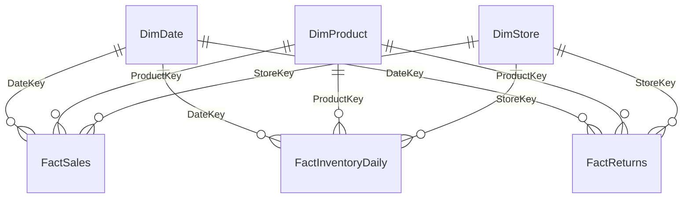

<!-- Generated by SpecStory, Markdown v2.1.0 -->

# 2026-11-09 08:56:57Z

<!-- Copilot CLI Session 03cdc871-d0bd-41d7-b113-71bb210acc74 (2026-11-09 08:56:57Z) -->

_**User (2026-11-09 08:56:57Z)**_

Napisz przykładowe zapytania SQL i outline notebooków 

---

_**Agent (Anthropic 2/claude-haiku-5-5 2026-11-09 08:56:59Z)**_

<tool-use data-tool-type="shell" data-tool-name="bash"><details>
<summary>Tool use: **bash**</summary>

List repo files and data sources

```bash
cd /home/teamsharq/Desktop/infoshare-silkycoders-data-science-ai-1 && git --no-pager ls-files | head -100 && echo --- && find . -name "*.csv" -o -name "*.db" -o -name "*.sqlite" -o -name "*.parquet" | grep -v node_modules | head -20
```

**Result:**

```text
README.md
datasets/daily_store_sales.csv
datasets/weekly_sales_lines.csv
docs/nordvik-opis-firmy.md
docs/slownik-metryk.md
sql/weekly_sales.sql
zgloszenia/01.md
---
./datasets/weekly_sales_lines.csv
./datasets/daily_store_sales.csv
<shellId: 0 completed with exit code 0>
```
</details></tool-use>

_**Agent (Anthropic 2/claude-haiku-5-5 2026-11-09 08:57:03Z)**_

<tool-use data-tool-type="shell" data-tool-name="bash"><details>
<summary>Tool use: **bash**</summary>

Read repo docs, SQL and dataset headers

```bash
cd /home/teamsharq/Desktop/infoshare-silkycoders-data-science-ai-1 && cat README.md && echo ---SQL && cat sql/weekly_sales.sql && echo ---ZG && cat zgloszenia/01.md && echo ---SLOWNIK && cat docs/slownik-metryk.md && echo ---FIRMA && cat docs/nordvik-opis-firmy.md && echo ---CSV && head -5 datasets/daily_store_sales.csv datasets/weekly_sales_lines.csv && wc -l datasets/*.csv
```

**Result:**

```text
Output too large to read at once (26.2 KB). Saved to: /tmp/1794214623145-copilot-tool-output-11778-1025cd9c-7925-45f6-a356-19aad0132b09.txt
Consider using tools like grep (for searching), head/tail (for viewing start/end), view with view_range (for specific sections), or jq (for JSON) to examine portions of the output.

Preview (first 500 chars):
# infoshare-silkycoders-data-science-ai-1---SQL
-- Grain: one row per order line. Dates are local business dates.
WITH line_sales AS (
  SELECT s.TransactionNo, s.LineNo, CAST(s.SoldAt AS date) AS SaleDate,
         s.StoreCode, s.SKU, s.Quantity, s.UnitNetPrice,
         s.Quantity * s.UnitNetPrice AS NetSalesBeforeReturns
  FROM dbo.SalesLine AS s
  WHERE s.SoldAt >= '2026-09-07' AND s.SoldAt < '2026-09-14'
    AND s.Status = 'COMPLETED'
), weekly AS (
  SELECT DATEPART(isowk, SaleDate) AS Iso
<shellId: 1 completed with exit code 0>
```
</details></tool-use>

_**Agent (Anthropic 2/claude-haiku-5-5 2026-11-09 08:57:04Z)**_

<tool-use data-tool-type="shell" data-tool-name="bash"><details>
<summary>Tool use: **bash**</summary>

Read docs, SQL and dataset headers

```bash
cd /home/teamsharq/Desktop/infoshare-silkycoders-data-science-ai-1 && cat sql/weekly_sales.sql && echo ---ZG && cat zgloszenia/01.md && echo ---SLOWNIK && cat docs/slownik-metryk.md && echo ---FIRMA && cat docs/nordvik-opis-firmy.md | head -150 && echo ---CSV && head -5 datasets/daily_store_sales.csv datasets/weekly_sales_lines.csv && wc -l datasets/*.csv
```

**Result:**

```text
Output too large to read at once (13.5 KB). Saved to: /tmp/1794214624671-copilot-tool-output-11778-18dac16c-3a8b-4067-ac6d-52f3bc45f836.txt
Consider using tools like grep (for searching), head/tail (for viewing start/end), view with view_range (for specific sections), or jq (for JSON) to examine portions of the output.

Preview (first 500 chars):
-- Grain: one row per order line. Dates are local business dates.
WITH line_sales AS (
  SELECT s.TransactionNo, s.LineNo, CAST(s.SoldAt AS date) AS SaleDate,
         s.StoreCode, s.SKU, s.Quantity, s.UnitNetPrice,
         s.Quantity * s.UnitNetPrice AS NetSalesBeforeReturns
  FROM dbo.SalesLine AS s
  WHERE s.SoldAt >= '2026-09-07' AND s.SoldAt < '2026-09-14'
    AND s.Status = 'COMPLETED'
), weekly AS (
  SELECT DATEPART(isowk, SaleDate) AS IsoWeek, StoreCode,
         SUM(NetSalesBeforeRetu
<shellId: 2 completed with exit code 0>
```
</details></tool-use>

_**Agent (Anthropic 2/claude-haiku-5-5 2026-11-09 08:57:06Z)**_

Pliki są duże, przeczytam je fragmentami.

_**Agent (Anthropic 2/claude-haiku-5-5 2026-11-09 08:57:06Z)**_

<tool-use data-tool-type="shell" data-tool-name="bash"><details>
<summary>Tool use: **bash**</summary>

Read request, metrics glossary, dataset heads

```bash
cd /home/teamsharq/Desktop/infoshare-silkycoders-data-science-ai-1 && cat zgloszenia/01.md; echo ---SLOWNIK; cat docs/slownik-metryk.md | head -120; echo ---CSV; head -4 datasets/daily_store_sales.csv; head -4 datasets/weekly_sales_lines.csv; wc -l datasets/*.csv
```

**Result:**

```text
Od: Olek, Senior Data Scientist
Do: Zespół Data Science
Temat: Wspólny sposób dokumentowania analiz

Cześć,

Coraz częściej przekazujemy sobie zapytania SQL i notebooki między projektami. Chciałbym, żeby osoba, która przejmuje analizę, mogła szybko zrozumieć, co robi kod, z jakich danych korzysta i jak sprawdzić jego wynik.

Zależy mi na przykładach, które moglibyśmy później wykorzystać jako punkt wyjścia dla całego zespołu.

Olek---SLOWNIK
# Słownik metryk Nordvik

Definicje używane w raportach sprzedaży, rentowności i zapasu. Kwoty podajemy w PLN, a udziały i dynamiki w procentach. Metryki liczymy dla wskazanego okresu i przekroju; jeśli w mianowniku jest zero, wynik wskaźnika pozostaje pusty.

## Sprzedaż

| Metryka | Definicja | Źródło |
| --- | --- | --- |
| **Sprzedaż brutto** | Wartość sprzedanego towaru z VAT, po rabacie. | `FactSales.GrossAmount` |
| **Rabat** | Kwota obniżki udzielonej na pozycjach sprzedaży. | `FactSales.DiscountAmount` |
| **Sprzedaż netto** | Sprzedaż brutto bez VAT; dla odzieży obowiązuje 23% VAT. | `FactSales.NetAmount` |
| **Sztuki** | Liczba sprzedanych sztuk. | `FactSales.Quantity` |
| **Wartość przed rabatem** | Wartość towaru według ceny sprzedaży przed obniżką, z VAT. | `SUM(FactSales.Quantity * FactSales.UnitPrice)` |
| **Stopa rabatu** | Rabat / wartość przed rabatem. | `FactSales` |
| **Średnia cena netto sztuki** | Sprzedaż netto / sztuki. | `FactSales` |
| **Udział kanału w sprzedaży** | Sprzedaż netto kanału / sprzedaż netto wszystkich kanałów w tym samym okresie. | `FactSales` + `DimStore.Channel` |
| **Zmiana sprzedaży tydzień do tygodnia** | (Sprzedaż netto bieżącego pełnego tygodnia − sprzedaż netto poprzedniego pełnego tygodnia) / sprzedaż netto poprzedniego tygodnia; oba tygodnie w tym samym przekroju. | `FactSales` + `DimDate` |
| **Sprzedaż po zwrotach netto** | Sprzedaż netto − wartość zwrotów bez VAT przyjętych w tym okresie. | `FactSales.NetAmount`, `FactReturns.ReturnAmount` |
| **Aktywne SKU** | Liczba różnych
… (output truncated)
```
</details></tool-use>

_**Agent (Anthropic 2/claude-haiku-5-5 2026-11-09 08:57:08Z)**_

<tool-use data-tool-type="shell" data-tool-name="bash"><details>
<summary>Tool use: **bash**</summary>

Read existing SQL, company doc, README

```bash
cd /home/teamsharq/Desktop/infoshare-silkycoders-data-science-ai-1 && cat sql/weekly_sales.sql; echo ---FIRMA; head -c 4000 docs/nordvik-opis-firmy.md; echo; echo ---README; cat README.md | head -c 3000
```

**Result:**

````text
-- Grain: one row per order line. Dates are local business dates.
WITH line_sales AS (
  SELECT s.TransactionNo, s.LineNo, CAST(s.SoldAt AS date) AS SaleDate,
         s.StoreCode, s.SKU, s.Quantity, s.UnitNetPrice,
         s.Quantity * s.UnitNetPrice AS NetSalesBeforeReturns
  FROM dbo.SalesLine AS s
  WHERE s.SoldAt >= '2026-09-07' AND s.SoldAt < '2026-09-14'
    AND s.Status = 'COMPLETED'
), weekly AS (
  SELECT DATEPART(isowk, SaleDate) AS IsoWeek, StoreCode,
         SUM(NetSalesBeforeReturns) AS WeeklyNetSalesBeforeReturns,
         COUNT(DISTINCT TransactionNo) AS TransactionCount,
         COUNT(*) AS LineCount
  FROM line_sales
  GROUP BY DATEPART(isowk, SaleDate), StoreCode
)
SELECT IsoWeek, StoreCode, WeeklyNetSalesBeforeReturns, TransactionCount, LineCount
FROM weekly ORDER BY StoreCode;
---FIRMA
# Nordvik — opis firmy i modelu działania

## Spis treści

1. Profil firmy
2. Model biznesowy
3. Sklepy i kanały
4. Asortyment i produkt
5. Organizacja i odpowiedzialności
6. Rytm pracy firmy
7. Dane: źródła i hurtownia
8. Metryki
9. Data Science w Nordvik
10. Słownik pojęć
11. Założenia i źródła

---

## 1. Profil firmy

| Obszar | Opis |
| --- | --- |
| Branża | Moda odzieżowa, sieć z własną ofertą (model *own brand*) |
| Sklepy stacjonarne | 5 |
| Sklep internetowy | 1 (kanał `ONLINE`) |
| Asortyment | Odzież damska i męska, akcesoria. Ok. 120 SKU (uproszczenie: prawdziwa sieć ma ich wielokrotnie więcej) |
| Sezony | `SS` (luty–lipiec) i `AW` (sierpień–styczeń), np. `AW26` |
| Waluta i VAT | PLN. VAT 23% na odzież |
| Historia danych | Sprzedaż od stycznia 2025. Stany magazynowe i zwroty za bieżący sezon |

---

## 2. Model biznesowy

### 2.1 Łańcuch wartości

```mermaid
flowchart LR
    A["Projekt kolekcji<br/>(zespół designu)"] --> B["Planowanie i zakupy<br/>(merchandising)"]
    B --> C["Produkcja<br/>(zewnętrzni dostawcy)"]
    C --> D["Magazyn centralny<br/>(WMS)"]
    D --> E["Dostawy do sklepów"]
    D --> F["Sklep internetowy"]
    E --> G["Sprzedaż 
… (output truncated)
````
</details></tool-use>

_**Agent (Anthropic 2/claude-haiku-5-5 2026-11-09 08:57:11Z)**_

<tool-use data-tool-type="shell" data-tool-name="bash"><details>
<summary>Tool use: **bash**</summary>

Read data sources and DS sections

```bash
cd /home/teamsharq/Desktop/infoshare-silkycoders-data-science-ai-1 && grep -n "^## \|^### " docs/nordvik-opis-firmy.md; sed -n '/^## 7\./,/^## 10\./p' docs/nordvik-opis-firmy.md | head -c 9000
```

**Result:**

```text
Output too large to read at once (9.7 KB). Saved to: /tmp/1794214631014-copilot-tool-output-11778-6b8c15b6-aa8d-4543-91a7-76e084196c6c.txt
Consider using tools like grep (for searching), head/tail (for viewing start/end), view with view_range (for specific sections), or jq (for JSON) to examine portions of the output.

Preview (first 500 chars):
3:## Spis treści
19:## 1. Profil firmy
33:## 2. Model biznesowy
35:### 2.1 Łańcuch wartości
52:### 2.2 Co firma zarabia i co ją kosztuje
62:### 2.3 Cykl życia produktu w sezonie
71:### 2.4 Kanały
82:## 3. Sklepy i kanały
97:## 4. Asortyment i produkt
99:### 4.1 Hierarchia produktu
108:### 4.2 Zasady asortymentu
118:## 5. Organizacja i odpowiedzialności
136:## 6. Rytm pracy firmy
151:## 7. Dane: źródła i hurtownia
153:### 7.1 Systemy źródłowe
162:### 7.2 Warstwy hurtowni
174:### 7.3 Model gwiazdy
<shellId: 5 completed with exit code 0>
```
</details></tool-use>

_**Agent (Anthropic 2/claude-haiku-5-5 2026-11-09 08:57:12Z)**_

<tool-use data-tool-type="shell" data-tool-name="bash"><details>
<summary>Tool use: **bash**</summary>

Read data warehouse section

```bash
cd /home/teamsharq/Desktop/infoshare-silkycoders-data-science-ai-1 && sed -n '151,230p' docs/nordvik-opis-firmy.md
```

**Result:**

````text
## 7. Dane: źródła i hurtownia

### 7.1 Systemy źródłowe

| System | Co wystawia | Plik | Tabela wejściowa |
| --- | --- | --- | --- |
| POS (kasy w sklepach) | Pozycje paragonów ze sklepów stacjonarnych | `POS_yyyymmdd.csv` | `src.SalesRaw` |
| Sklep internetowy | Pozycje zamówień online | `WEB_yyyymmdd.csv` | `src.SalesRaw` |
| WMS (magazyn) | Stany na koniec dnia, osobny plik na dzień | `WMS_yyyymmdd.csv` | `src.InventoryRaw` |
| Portal zwrotów | Przyjęte zwroty | `RET_yyyymm.csv` | `src.ReturnsRaw` |

### 7.2 Warstwy hurtowni

Dane płyną w jedną stronę: `src` → `stg` → `dbo` → `reporting`.

| Schemat | Zawartość | Uwaga |
| --- | --- | --- |
| `src` | Dane takie, jak przysłał system źródłowy. Wszystko tekstowe, bez walidacji | Źródło prawdy o tym, co przyszło |
| `stg` | Dane po konwersji typów | Wiersze, których nie da się przekonwertować, odpadają |
| `dbo` | Wymiary i fakty | Właściwa hurtownia |
| `reporting` | Widoki raportowe | Warstwa, z której korzysta biznes |
| `etl` | Procedury ładujące | Pełne przeładowanie przy każdym uruchomieniu |

### 7.3 Model gwiazdy



| Tabela | Typ | Ziarno (jeden wiersz to…) | Najważniejsze kolumny |
| --- | --- | --- | --- |
| `dbo.DimDate` | Wymiar | Dzień | `DateKey`, `YearWeek` (np. `2026-W38`), `YearMonth`, `Season`, `IsWeekend` |
| `dbo.DimProduct` | Wymiar | SKU | `SKU`, `StyleCode`, `Department`, `Category`, `Color`, `Size`, `ListPrice`, `UnitCost`, `IsActive` |
| `dbo.DimStore` | Wymiar | Sklep (także online) | `StoreKey`, `StoreCode`, `City`, `Region`, `Channel`, `Format`,
… (output truncated)
````
</details></tool-use>

_**Agent (Anthropic 2/claude-haiku-5-5 2026-11-09 08:57:14Z)**_

<tool-use data-tool-type="shell" data-tool-name="bash"><details>
<summary>Tool use: **bash**</summary>

Read Data Science section and metrics summary

```bash
cd /home/teamsharq/Desktop/infoshare-silkycoders-data-science-ai-1 && sed -n '/^## 9\./,/^## 10\./p' docs/nordvik-opis-firmy.md | head -c 6000; echo; echo ---; sed -n '/^## 8\./,/^## 9\./p' docs/nordvik-opis-firmy.md | head -c 2500
```

**Result:**

```text
## 9. Data Science w Nordvik

Analityk odpowiada na pytanie „co się stało i dlaczego?". Data Science odpowiada na pytania „co się stanie?", „co da lepszy wynik?" i „czy to naprawdę zadziałało?".

### 9.1 Podział ról

| Działanie | Analityk | Data Scientist | Data Engineer |
| --- | --- | --- | --- |
| Pytanie „co się stało?" | Główny wykonawca | Wsparcie | Dostarcza dane |
| Pytanie „co się stanie?" | Ocena wyniku | Główny wykonawca | Dostarcza dane |
| Definicje metryk | Współtworzy | Używa | Wdraża w hurtowni |
| Jakość i ładowanie danych | Zgłasza problemy | Zgłasza problemy | Główny wykonawca |
| Wdrożenie i monitoring modelu | Sprawdza wynik | Główny wykonawca | Wspólnie |
| Raport dla biznesu | Główny wykonawca | Dostarcza wynik modelu | Nie dotyczy |

### 9.2 Obszary pracy Data Science

| # | Obszar | Problem biznesowy | Dane wejściowe | Wynik dla biznesu | Status dziś |
| --- | --- | --- | --- | --- | --- |
| 1 | Prognoza popytu | Ile sztuk modelu sprzedamy w sklepie w ciągu 4 tygodni? | `FactSales`, `DimDate`, `DimProduct`, `DimStore` | Prognoza na tydzień × SKU × sklep. Podstawa zakupów i alokacji | Możliwe z tabel faktów |
| 2 | Prognoza sell-through i moment przeceny | Czy zapas dojdzie do końca sezonu? Kiedy obniżyć cenę? | `FactSales`, `FactInventoryDaily` | Data i poziom rabatu dla modelu | Możliwe dla bieżącego sezonu |
| 3 | Elastyczność cenowa | O ile spadnie popyt przy −20%? | `FactSales.UnitPrice`, `DiscountAmount`, `Quantity` | Krzywa popytu i rekomendacja rabatu | Możliwe. Trzeba odsiać sezonowość |
| 4 | Krzywa rozmiarów i alokacja | Jaki udział każdego rozmiaru zamówić i rozdać do sklepów? | `FactSales`, `FactInventoryDaily`, `DimProduct.Size` | Proporcje rozmiarów dla sklepu i kanału | Możliwe |
| 5 | Uzupełnianie zapasu | Kiedy i ile dosłać do sklepu? | `FactInventoryDaily`, prognoza popytu | Minimalny i docelowy stan dla SKU × sklep | Częściowo. Brak danych o dostawach |
| 6 | Prognoza zwrotów | Które modele i rozmiary będą najczęściej zwr
… (output truncated)
```
</details></tool-use>
