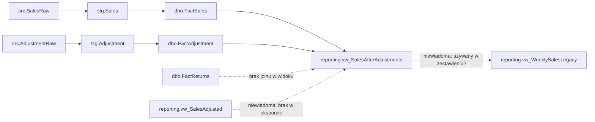
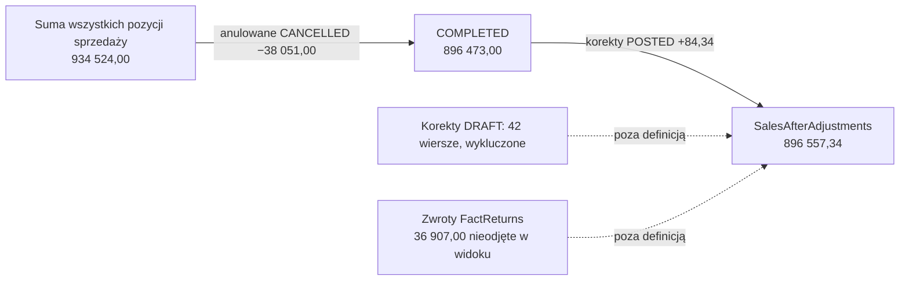
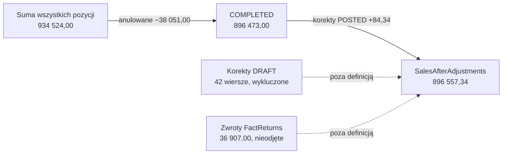

<!-- Generated by SpecStory, Markdown v2.1.0 -->

# 2026-11-09 11:28:50Z

<!-- Copilot CLI Session 6c06b0ec-ba51-441b-927c-ff53fce57a8e (2026-11-09 11:28:50Z) -->

_**User (2026-11-09 11:28:50Z)**_

zrób analizę przyczyn różnic

Format:
# Tabela lineage

| Pole biznesowe | Kolumna techniczna | Raport/widok | Transformacja/formuła | Źródło | Ziarno na poziomie | Wersja/czas | Dowód albo niewiadoma |
|---|---|---|---|---|---|---|---|
| sprzedaż po korektach | | | | | | | |

## Komunikat dla controllingu

- **Ustalone fakty:**
- **Hipotezy (i co trzeba sprawdzić):**
- **Braki / granice wniosku:**
- **Krótka odpowiedź:**

---

_**Agent (Anthropic 2/claude-haiku-5-5 2026-11-09 11:28:53Z)**_

<tool-use data-tool-type="shell" data-tool-name="bash"><details>
<summary>Tool use: **bash**</summary>

Read tagged ticket file and list folder

```bash
cd /home/teamsharq/Desktop/infoshare-silkycoders-data-science-ai-1 && cat zgloszenia/E02-B/E02-B.md && echo ---- && ls -la zgloszenia/E02-B/ && git --no-pager log --oneline -5 -- zgloszenia/E02-B 2>/dev/null
```

**Result:**

```text
# Wiadomości z Teams — 14 października, 09:12

**Marta, controlling:** W tygodniowym zestawieniu pole „sprzedaż po korektach” różni się od sumy paragonów. Potrzebuję dziś krótkiej odpowiedzi: skąd ta liczba pochodzi i jaka jest jej formuła? Proszę oddzielić ustalenia od przypuszczeń.

**Olek, analityka:** W katalogu widziałem widok o nazwie `SalesAfterAdjustments`. Sprawdzę, czy to wystarcza do potwierdzenia definicji.

**Iga, data engineering:** W logu ostatniego ładowania są odrzucone rekordy. Sam log pokazuje przebieg; nie wyjaśnia definicji raportowej.
----
total 292
drwxr-xr-x 2 teamsharq teamsharq   4096 Nov  9 12:16 .
drwxr-xr-x 4 teamsharq teamsharq   4096 Nov  9 12:16 ..
-rw-r--r-- 1 teamsharq teamsharq    798 Nov  9 12:16 adjustment_lineage.sql
-rw-r--r-- 1 teamsharq teamsharq    589 Nov  9 12:16 E02-B.md
-rw-r--r-- 1 teamsharq teamsharq   1016 Nov  9 12:16 implementacja.sql
-rw-r--r-- 1 teamsharq teamsharq   1256 Nov  9 12:16 katalog.md
-rw-r--r-- 1 teamsharq teamsharq    194 Nov  9 12:16 loadlog.csv
-rw-r--r-- 1 teamsharq teamsharq 260607 Nov  9 12:16 przyklad_wierszy.csv
-rw-r--r-- 1 teamsharq teamsharq   2067 Nov  9 12:16 schema.sql
-rw-r--r-- 1 teamsharq teamsharq    786 Nov  9 12:16 staging_fact.sql
eb405e0 E02-B - pole „sprzedaż po korektach”
<shellId: 33 completed with exit code 0>
```
</details></tool-use>

_**Agent (Anthropic 2/claude-haiku-5-5 2026-11-09 11:28:55Z)**_

<tool-use data-tool-type="shell" data-tool-name="bash"><details>
<summary>Tool use: **bash**</summary>

Read all supporting files and CSV sample

```bash
cd /home/teamsharq/Desktop/infoshare-silkycoders-data-science-ai-1/zgloszenia/E02-B && for f in adjustment_lineage.sql implementacja.sql katalog.md loadlog.csv schema.sql staging_fact.sql; do echo "==== $f"; cat "$f"; echo; done; echo "==== csv head"; head -5 przyklad_wierszy.csv; wc -l przyklad_wierszy.csv
```

**Result:**

```text
==== adjustment_lineage.sql
-- Adjustment ETL excerpt, release REL-2026.10.3
INSERT stg.Adjustment(AdjustmentId,StoreCode,AdjustedAt,AdjustmentType,AdjustmentAmount,ApprovalStatus,SourceFile,ExtractedAt)
SELECT AdjustmentId,StoreCode,TRY_CONVERT(date,AdjustedAt),AdjustmentType,TRY_CONVERT(decimal(12,2),AdjustmentAmount),ApprovalStatus,SourceFile,ExtractedAt
FROM src.AdjustmentRaw;
INSERT dbo.FactAdjustment(DateKey,StoreKey,AdjustmentId,AdjustmentTypeKey,AdjustmentAmount,ApprovalStatus)
SELECT d.DateKey,st.StoreKey,a.AdjustmentId,t.AdjustmentTypeKey,a.AdjustmentAmount,a.ApprovalStatus
FROM stg.Adjustment a JOIN dbo.DimDate d ON d.FullDate=a.AdjustedAt
JOIN dbo.DimStore st ON st.StoreCode=a.StoreCode
JOIN dbo.DimAdjustmentType t ON t.Label=a.AdjustmentType;
-- SourceFile/ExtractedAt are not copied to FactAdjustment.

==== implementacja.sql
-- Aktualny wyciąg wdrożeniowy scenariusza: REL-2026.10.3, opublikowany 2026-10-13 17:20 Europe/Warsaw.
-- SourceFile zachowane w raw i staging; brak w faktach dbo.
CREATE VIEW reporting.vw_SalesAfterAdjustments AS
WITH sales AS (
 SELECT s.StoreKey, d.IsoYearWeek,
        SUM(s.Quantity * s.UnitNetPrice) AS BaseNetSales
 FROM dbo.FactSales s JOIN dbo.DimDate d ON d.DateKey=s.DateKey
 WHERE s.Status='COMPLETED' GROUP BY s.StoreKey,d.IsoYearWeek
), adj AS (
 SELECT a.StoreKey, d.IsoYearWeek, SUM(a.AdjustmentAmount) AS Adjustments
 FROM dbo.FactAdjustment a JOIN dbo.DimDate d ON d.DateKey=a.DateKey
 WHERE a.ApprovalStatus='POSTED' GROUP BY a.StoreKey,d.IsoYearWeek
)
SELECT s.StoreKey,s.IsoYearWeek,
       s.BaseNetSales + COALESCE(a.Adjustments,0) AS SalesAfterAdjustments
FROM sales s LEFT JOIN adj a ON a.StoreKey=s.StoreKey AND a.IsoYearWeek=s.IsoYearWeek;
-- Nie ma joinu FactReturns; wynik nie jest po zwrotach.
-- FactSales grain = transaction line; agregacja przed joinem z korektami chroni ziarno.

==== katalog.md
# Katalog obiektów  
Wersja katalogu `CAT-2026.10`, eksport 2026-10-14 08:00 Europe/Warsaw.

| Obiekt | Ziarno | Klucz 
… (output truncated)
```
</details></tool-use>

_**Agent (Anthropic 2/claude-haiku-5-5 2026-11-09 11:28:59Z)**_

Mam definicje. Teraz sprawdzę próbkę danych pod kątem przyczyn różnic.

_**Agent (Anthropic 2/claude-haiku-5-5 2026-11-09 11:29:14Z)**_

<tool-use data-tool-type="shell" data-tool-name="bash"><details>
<summary>Tool use: **bash**</summary>

Profile sample CSV for duplicates, statuses, layers

```bash
cd /home/teamsharq/Desktop/infoshare-silkycoders-data-science-ai-1/zgloszenia/E02-B && python3 - <<'EOF'
import csv,collections
rows=[r for r in csv.reader(l for l in open('przyklad_wierszy.csv',encoding='utf-8') if not l.startswith('#'))]
h=rows[0]; data=[dict(zip(h,r)) for r in rows[1:] if len(r)==len(h)]
print("rows",len(data),"bad-len",len(rows)-1-len(data))
print("layers",collections.Counter(d['layer'] for d in data))
print("runs",collections.Counter(d['RunId'] for d in data))
print("status sales",collections.Counter(d['Status'] for d in data if d['layer']=='FactSales'))
print("approval",collections.Counter(d['ApprovalStatus'] for d in data if d['layer']=='FactAdjustment'))
print("adj types/rows", sum(1 for d in data if d['layer']=='FactAdjustment'))
tx=collections.Counter((d['TransactionNo'],d['LineNo']) for d in data if d['layer']=='FactSales')
print("dup sales keys",sum(1 for k,v in tx.items() if v>1), "dup rows",sum(v-1 for v in tx.values() if v>1))
adj=collections.Counter(d['AdjustmentId'] for d in data if d['layer']=='FactAdjustment')
print("dup adj ids",sum(1 for v in adj.values() if v>1))
print("blank/unparsed amounts", sum(1 for d in data if d['layer']=='FactSales' and not d['UnitNetPrice']))
print("weeks sample",collections.Counter((d['StoreKey'],d['IsoYearWeek']) for d in data).most_common(3))
ret=[d for d in data if d['layer']=='FactReturns']; print("returns",len(ret))
EOF
echo; grep -c "" przyklad_wierszy.csv; grep '^#' przyklad_wierszy.csv | head
```

**Result:**

```text
rows 3705 bad-len 0
layers Counter({'FactSales': 3226, 'FactAdjustment': 312, 'FactReturns': 165, 'RejectedSales': 2})
runs Counter({'': 3693, 'RUN-26014': 12})
status sales Counter({'COMPLETED': 3101, 'CANCELLED': 125})
approval Counter({'POSTED': 270, 'DRAFT': 42})
adj types/rows 312
dup sales keys 0 dup rows 0
dup adj ids 0
blank/unparsed amounts 0
weeks sample [(('11', '2026-W25'), 27), (('11', '2024-W13'), 25), (('11', '2024-W37'), 24)]
returns 165

3707
# Synthetic scenario rows; EventDate is the business date; RUN-26014 marks the fixed raw-load sample.
<shellId: 35 completed with exit code 0>
```
</details></tool-use>

_**Agent (Anthropic 2/claude-haiku-5-5 2026-11-09 11:29:23Z)**_

<tool-use data-tool-type="shell" data-tool-name="bash"><details>
<summary>Tool use: **bash**</summary>

Show rejected/run rows and reconcile totals

```bash
cd /home/teamsharq/Desktop/infoshare-silkycoders-data-science-ai-1/zgloszenia/E02-B && grep -E "RejectedSales|RUN-26014" przyklad_wierszy.csv | head -20; python3 - <<'EOF'
import csv,collections
rows=[r for r in csv.reader(l for l in open('przyklad_wierszy.csv',encoding='utf-8') if not l.startswith('#'))]
h=rows[0]; data=[dict(zip(h,r)) for r in rows[1:]]
S=collections.defaultdict(float); A_posted=collections.defaultdict(float); A_all=collections.defaultdict(float); R=collections.defaultdict(float); Sall=collections.defaultdict(float)
for d in data:
    k=(d['StoreKey'],d['IsoYearWeek'])
    if d['layer']=='FactSales':
        v=float(d['Quantity'])*float(d['UnitNetPrice'])
        Sall[k]+=v
        if d['Status']=='COMPLETED': S[k]+=v
    if d['layer']=='FactAdjustment':
        A_all[k]+=float(d['AdjustmentAmount'])
        if d['ApprovalStatus']=='POSTED': A_posted[k]+=float(d['AdjustmentAmount'])
    if d['layer']=='FactReturns': R[k]+=float(d['ReturnAmount'])
tot=lambda x:round(sum(x.values()),2)
print("sales all",tot(Sall),"completed",tot(S),"adj posted",tot(A_posted),"adj all",tot(A_all),"returns",tot(R))
print("view-style (completed+posted)",round(tot(S)+tot(A_posted),2))
print("completed+all adj",round(tot(S)+tot(A_all),2))
print("sales all + posted", round(tot(Sall)+tot(A_posted),2))
print("W41 store7 sample:", S[('7','2026-W41')], A_posted[('7','2026-W41')], A_all[('7','2026-W41')], Sall[('7','2026-W41')])
neg=[d for d in data if d['layer']=='FactAdjustment' and d['AdjustmentAmount'].startswith('-')]; print("neg adj",len(neg))
EOF
```

**Result:**

```text
# Synthetic scenario rows; EventDate is the business date; RUN-26014 marks the fixed raw-load sample.
FactSales,7,2026-W41,2026-10-05,T-100,1,2,50.00,,,,,,COMPLETED,RUN-26014
FactSales,7,2026-W41,2026-10-06,T-101,1,1,40.00,,,,,,COMPLETED,RUN-26014
FactSales,7,2026-W42,2026-10-12,T-102,1,1,20.00,,,,,,COMPLETED,RUN-26014
FactSales,7,2026-W42,2026-10-13,T-103,1,3,10.00,,,,,,COMPLETED,RUN-26014
FactSales,8,2026-W41,2026-10-05,T-200,1,1,100.00,,,,,,COMPLETED,RUN-26014
FactSales,8,2026-W41,2026-10-06,T-201,1,2,25.00,,,,,,COMPLETED,RUN-26014
FactSales,8,2026-W42,2026-10-12,T-202,1,2,15.00,,,,,,COMPLETED,RUN-26014
FactSales,9,2026-W41,2026-10-05,T-300,1,1,60.00,,,,,,COMPLETED,RUN-26014
FactSales,9,2026-W42,2026-10-12,T-301,1,2,40.00,,,,,,CANCELLED,RUN-26014
FactSales,9,2026-W42,2026-10-13,T-302,1,2,40.00,,,,,,COMPLETED,RUN-26014
RejectedSales,,,2026-10-14,,,,,,,,,,REJECTED,RUN-26014
RejectedSales,,,2026-10-15,,,,,,,,,,REJECTED,RUN-26014
sales all 934524.0 completed 896473.0 adj posted 84.34 adj all -35.15 returns 36907.0
view-style (completed+posted) 896557.34
completed+all adj 896437.85
sales all + posted 934608.34
W41 store7 sample: 140.0 -5.0 -55.0 140.0
neg adj 159
<shellId: 36 completed with exit code 0>
```
</details></tool-use>

_**Agent (Anthropic 2/claude-haiku-5-5 2026-11-09 11:29:32Z)**_

<tool-use data-tool-type="shell" data-tool-name="bash"><details>
<summary>Tool use: **bash**</summary>

Check adjustments dropped by LEFT JOIN

```bash
cd /home/teamsharq/Desktop/infoshare-silkycoders-data-science-ai-1/zgloszenia/E02-B && python3 - <<'EOF'
import csv,collections
rows=[r for r in csv.reader(l for l in open('przyklad_wierszy.csv',encoding='utf-8') if not l.startswith('#'))]
h=rows[0]; data=[dict(zip(h,r)) for r in rows[1:]]
sk={(d['StoreKey'],d['IsoYearWeek']) for d in data if d['layer']=='FactSales' and d['Status']=='COMPLETED'}
lost=[d for d in data if d['layer']=='FactAdjustment' and d['ApprovalStatus']=='POSTED' and (d['StoreKey'],d['IsoYearWeek']) not in sk]
print("posted adj in store-weeks without completed sales:",len(lost), round(sum(float(d['AdjustmentAmount']) for d in lost),2))
wk=collections.Counter(d['EventDate'][:4] for d in data if d['EventDate'] and d['layer']=='FactSales')
print(wk)
EOF
```

**Result:**

```text
posted adj in store-weeks without completed sales: 1 23.83
Counter({'2024': 1173, '2025': 1064, '2026': 989})
<shellId: 37 completed with exit code 0>
```
</details></tool-use>

_**Agent (Anthropic 2/claude-haiku-5-5 2026-11-09 11:29:49Z)**_

# Tabela lineage

| Pole biznesowe | Kolumna techniczna | Raport/widok | Transformacja/formuła | Źródło | Ziarno na poziomie | Wersja/czas | Dowód albo niewiadoma |
|---|---|---|---|---|---|---|---|
| sprzedaż po korektach | `reporting.vw_SalesAfterAdjustments.SalesAfterAdjustments` | `reporting.vw_SalesAfterAdjustments` | `SUM(Quantity × UnitNetPrice)` dla `Status='COMPLETED'` + `COALESCE(SUM(AdjustmentAmount),0)` dla `ApprovalStatus='POSTED'`, po sklepie i `IsoYearWeek`, LEFT JOIN | `dbo.FactSales` ← `stg.Sales` ← `src.SalesRaw`; `dbo.FactAdjustment` ← `stg.Adjustment` ← `src.AdjustmentRaw` | sklep × ISO tydzień | REL-2026.10.3, opublikowane 2026-10-13 17:20 (Europe/Warsaw); katalog CAT-2026.10 z 2026-10-14 08:00 | Dowód: [implementacja.sql](/home/teamsharq/Desktop/infoshare-silkycoders-data-science-ai-1/zgloszenia/E02-B/implementacja.sql), [staging_fact.sql](/home/teamsharq/Desktop/infoshare-silkycoders-data-science-ai-1/zgloszenia/E02-B/staging_fact.sql), [adjustment_lineage.sql](/home/teamsharq/Desktop/infoshare-silkycoders-data-science-ai-1/zgloszenia/E02-B/adjustment_lineage.sql). Niewiadoma: definicja „sumy paragonów” po stronie controllingu. |
| sprzedaż po korektach (wariant pominięty w widoku) | brak w `vw_SalesAfterAdjustments` | `dbo.FactReturns` | Zwroty nie są odejmowane (brak joinu) | `dbo.FactReturns` | pozycja zwrotu | REL-2026.10.3 | Dowód: komentarz w `implementacja.sql`. W próbce zwroty = 36 907,00 zł. |
| sprzedaż po korektach (starsze raporty) | `reporting.vw_WeeklySalesLegacy` | obiekt wycofany | Tydzień kalendarzowy, nie ISO | nieznane | sklep × tydzień kalendarzowy | emerytowany wg katalogu | Dowód: [katalog.md](/home/teamsharq/Desktop/infoshare-silkycoders-data-science-ai-1/zgloszenia/E02-B/katalog.md). Niewiadoma: czy zestawienie tygodniowe nie korzysta z tego obiektu. |
| sprzedaż po korektach (alias) | `reporting.vw_SalesAdjusted` | nieznany | nieznana | nieznane | nieznane | brak w eksporcie | Niewiadoma: nie da się zweryfikować definicji. |

## Komunikat dla controllingu

- **Ustalone fakty:**
  - Pole pochodzi z `reporting.vw_SalesAfterAdjustments` i ma formułę: sprzedaż netto z pozycji `COMPLETED` + korekty `POSTED`, zsumowane per sklep i ISO tydzień (wersja REL-2026.10.3).
  - Suma paragonów i pole raportowe liczą różne zbiory. W próbce (`przyklad_wierszy.csv`, 3 705 wierszy) suma wszystkich pozycji sprzedaży wynosi 934 524,00. Pozycje `CANCELLED` (125 pozycji) dają różnicę 38 051,00, czyli 934 524,00 − 896 473,00.
  - Korekty `DRAFT` (42 wiersze) są wykluczone. Korekty `POSTED` dają +84,34. Widok nie odejmuje zwrotów (36 907,00 w próbce).
  - Wynik widoku na próbce: 896 473,00 + 84,34 = **896 557,34**.
  - Load log RUN-26014: 12 wierszy odczytanych, 10 załadowanych, 2 odrzucone. Odrzucone wiersze (`RejectedSales`, daty 2026-10-14 i 2026-10-15) nie trafiają do faktów, więc nie ma ich w żadnej z sum.
  - Jedna korekta POSTED (23,83) przypada na sklep i tydzień bez sprzedaży COMPLETED. LEFT JOIN w widoku ją gubi.
- **Hipotezy (i co trzeba sprawdzić):**
  - Różnica względem „sumy paragonów” wynika najpewniej z anulowanych pozycji (38 051) i pominięcia zwrotów (36 907). Trzeba potwierdzić, czy controlling liczy paragony przed czy po zwrotach i anulowaniach.
  - Rozbieżność może wynikać z przypisania do tygodnia ISO zamiast kalendarzowego, jeśli zestawienie korzysta z obiektu legacy. Sprawdzić źródło zestawienia tygodniowego.
  - Cicha utrata danych: `TRY_CONVERT` zwraca NULL dla błędnych dat i kwot, a potem INNER JOIN do `DimDate`, `DimStore` i `DimProduct` odrzuca wiersz bez komunikatu w `LoadLog`. Trzeba porównać liczbę wierszy `src` z `stg` i `Fact` dla każdego ładowania.
  - Kwota dodatnia czy ujemna korekty: w `FactAdjustment` kwoty są signed (159 ujemnych w próbce). Trzeba potwierdzić, że źródło zwraca je ze znakiem zgodnym z definicją.
- **Braki / granice wniosku:**
  - `przyklad_wierszy.csv` to dane syntetyczne (`Synthetic scenario rows`), a nie produkcyjne. Próbka nie dowodzi wielkości różnicy w rzeczywistym tygodniowym zestawieniu.
  - Nie mam definicji „sumy paragonów” ani zapytania zestawienia tygodniowego.
  - Nie zweryfikowano `vw_SalesAdjusted`, bo nie ma go w eksporcie schematu.
  - Brak danych o liczbie wierszy odrzuconych przez `TRY_CONVERT` i joinami wymiarów w pełnych ładowaniach.
- **Krótka odpowiedź:** Liczba pochodzi z `reporting.vw_SalesAfterAdjustments` (REL-2026.10.3). Formuła to: sprzedaż netto z pozycji COMPLETED + korekty POSTED per sklep i ISO tydzień. Różnica względem paragonów wynika z tego, że widok pomija anulowane pozycje, nie odejmuje zwrotów i pomija korekty bez sprzedaży w tym samym tygodniu. Nie jest to wynik błędu w wartościach, tylko innej definicji. Przed zamknięciem sprawy trzeba potwierdzić definicję „sumy paragonów” i sprawdzić, czy zestawienie nie używa obiektu legacy.

---

_**User (2026-11-09 11:34:23Z)**_

Dla przejrzystości zapisz tabele, komunikat i dwa diagramy mermaid w zgloszenia/E02-B/tabela_i_diagramy.md, z legendą (linia ciągła = potwierdzone w SQL, przerywana = niewiadoma) i jednym zdaniem pod każdym diagramem o źródle liczb.

Lineage (flowchart): src.SalesRaw → stg.Sales → dbo.FactSales → reporting.vw_SalesAfterAdjustments, oraz to samo dla korekt. Ścieżka ma kilka etapów, a controlling pyta głównie „skąd ta liczba”. Niesprawdzone elementy (vw_SalesAdjusted, vw_WeeklySalesLegacy, zwroty) można oznaczyć linią przerywaną, żeby diagram nie sugerował pewności.

Mostek kwot (flowchart z kwotami): suma wszystkich pozycji 934 524,00 → anulowane −38 051,00 → COMPLETED 896 473,00 → korekty POSTED +84,34 → 896 557,34. Mermaid nie ma dobrego wykresu wodospadowego, więc lepszy będzie łańcuch węzłów z kwotami niż xychart-beta.

---

_**Agent (Anthropic 2/claude-haiku-5-5 2026-11-09 11:34:41Z)**_

<tool-use data-tool-type="write" data-tool-name="create"><details>
<summary>Tool use: **create**</summary>

create a new file at /home/teamsharq/Desktop/infoshare-silkycoders-data-science-ai-1/zgloszenia/E02-B/tabela_i_diagramy.md.

Path: `/home/teamsharq/Desktop/infoshare-silkycoders-data-science-ai-1/zgloszenia/E02-B/tabela_i_diagramy.md`

````markdown
# Tabela lineage

| Pole biznesowe | Kolumna techniczna | Raport/widok | Transformacja/formuła | Źródło | Ziarno na poziomie | Wersja/czas | Dowód albo niewiadoma |
|---|---|---|---|---|---|---|---|
| sprzedaż po korektach | `reporting.vw_SalesAfterAdjustments.SalesAfterAdjustments` | `reporting.vw_SalesAfterAdjustments` | `SUM(Quantity × UnitNetPrice)` dla `Status='COMPLETED'` + `COALESCE(SUM(AdjustmentAmount),0)` dla `ApprovalStatus='POSTED'`, po sklepie i `IsoYearWeek`, LEFT JOIN | `dbo.FactSales` ← `stg.Sales` ← `src.SalesRaw`; `dbo.FactAdjustment` ← `stg.Adjustment` ← `src.AdjustmentRaw` | sklep × ISO tydzień | REL-2026.10.3, opublikowane 2026-10-13 17:20 (Europe/Warsaw); katalog CAT-2026.10 z 2026-10-14 08:00 | Dowód: [implementacja.sql](/home/teamsharq/Desktop/infoshare-silkycoders-data-science-ai-1/zgloszenia/E02-B/implementacja.sql), [staging_fact.sql](/home/teamsharq/Desktop/infoshare-silkycoders-data-science-ai-1/zgloszenia/E02-B/staging_fact.sql), [adjustment_lineage.sql](/home/teamsharq/Desktop/infoshare-silkycoders-data-science-ai-1/zgloszenia/E02-B/adjustment_lineage.sql). Niewiadoma: definicja „sumy paragonów” po stronie controllingu. |
| sprzedaż po korektach (wariant pominięty w widoku) | brak w `vw_SalesAfterAdjustments` | `dbo.FactReturns` | Zwroty nie są odejmowane (brak joinu) | `dbo.FactReturns` | pozycja zwrotu | REL-2026.10.3 | Dowód: komentarz w `implementacja.sql`. W próbce zwroty = 36 907,00 zł. |
| sprzedaż po korektach (starsze raporty) | `reporting.vw_WeeklySalesLegacy` | obiekt wycofany | Tydzień kalendarzowy, nie ISO | nieznane | sklep × tydzień kalendarzowy | emerytowany wg katalogu | Dowód: [katalog.md](/home/teamsharq/Desktop/infoshare-silkycoders-data-science-ai-1/zgloszenia/E02-B/katalog.md). Niewiadoma: czy zestawienie tygodniowe nie korzysta z tego obiektu. |
| sprzedaż po korektach (alias) | `reporting.vw_SalesAdjusted` | nieznany | nieznana | nieznane | nieznane | brak w eksporcie | Niewiadoma: nie da się zweryfikować definicji. |

## Komunikat dla controllingu

- **Ustalone fakty:**
  - Pole pochodzi z `reporting.vw_SalesAfterAdjustments` i ma formułę: sprzedaż netto z pozycji `COMPLETED` + korekty `POSTED`, zsumowane per sklep i ISO tydzień (wersja REL-2026.10.3).
  - Suma paragonów i pole raportowe liczą różne zbiory. W próbce (`przyklad_wierszy.csv`, 3 705 wierszy) suma wszystkich pozycji sprzedaży wynosi 934 524,00. Pozycje `CANCELLED` (125 pozycji) dają różnicę 38 051,00, czyli 934 524,00 − 896 473,00.
  - Korekty `DRAFT` (42 wiersze) są wykluczone. Korekty `POSTED` dają +84,34. Widok nie odejmuje zwrotów (36 907,00 w próbce).
  - Wynik widoku na próbce: 896 473,00 + 84,34 = **896 557,34**.
  - Load log RUN-26014: 12 wierszy odczytanych, 10 załadowanych, 2 odrzucone. Odrzucone wiersze (`RejectedSales`, daty 2026-10-14 i 2026-10-15) nie trafiają do faktów, więc nie ma ich w żadnej z sum.
  - Jedna korekta POSTED (23,83) przypada na sklep i tydzień bez sprzedaży COMPLETED. LEFT JOIN w widoku ją gubi.
- **Hipotezy (i co trzeba sprawdzić):**
  - Różnica względem „sumy paragonów” wynika najpewniej z anulowanych pozycji (38 051) i pominięcia zwrotów (36 907). Trzeba potwierdzić, czy controlling liczy paragony przed czy po zwrotach i anulowaniach.
  - Rozbieżność może wynikać z przypisania do tygodnia ISO zamiast kalendarzowego, jeśli zestawienie korzysta z obiektu legacy. Sprawdzić źródło zestawienia tygodniowego.
  - Cicha utrata danych: `TRY_CONVERT` zwraca NULL dla błędnych dat i kwot, a potem INNER JOIN do `DimDate`, `DimStore` i `DimProduct` odrzuca wiersz bez komunikatu w `LoadLog`. Trzeba porównać liczbę wierszy `src` z `stg` i `Fact` dla każdego ładowania.
  - Kwota dodatnia czy ujemna korekty: w `FactAdjustment` kwoty są signed (159 ujemnych w próbce). Trzeba potwierdzić, że źródło zwraca je ze znakiem zgodnym z definicją.
- **Braki / granice wniosku:**
  - `przyklad_wierszy.csv` to dane syntetyczne (`Synthetic scenario rows`), a nie produkcyjne. Próbka nie dowodzi wielkości różnicy w rzeczywistym tygodniowym zestawieniu.
  - Nie mam definicji „sumy paragonów” ani zapytania zestawienia tygodniowego.
  - Nie zweryfikowano `vw_SalesAdjusted`, bo nie ma go w eksporcie schematu.
  - Brak danych o liczbie wierszy odrzuconych przez `TRY_CONVERT` i joinami wymiarów w pełnych ładowaniach.
- **Krótka odpowiedź:** Liczba pochodzi z `reporting.vw_SalesAfterAdjustments` (REL-2026.10.3). Formuła to: sprzedaż netto z pozycji COMPLETED + korekty POSTED per sklep i ISO tydzień. Różnica względem paragonów wynika z tego, że widok pomija anulowane pozycje, nie odejmuje zwrotów i pomija korekty bez sprzedaży w tym samym tygodniu. Nie jest to wynik błędu w wartościach, tylko innej definicji. Przed zamknięciem sprawy trzeba potwierdzić definicję „sumy paragonów” i sprawdzić, czy zestawienie nie używa obiektu legacy.

## Diagramy

**Legenda:** linia ciągła (`-->`) = potwierdzone w SQL; linia przerywana (`-.->`) = niewiadoma albo element spoza definicji widoku (nie wchodzi do wyniku).

### Lineage



Liczby w diagramie pochodzą z definicji obiektów w [implementacja.sql](/home/teamsharq/Desktop/infoshare-silkycoders-data-science-ai-1/zgloszenia/E02-B/implementacja.sql), [staging_fact.sql](/home/teamsharq/Desktop/infoshare-silkycoders-data-science-ai-1/zgloszenia/E02-B/staging_fact.sql) i [adjustment_lineage.sql](/home/teamsharq/Desktop/infoshare-silkycoders-data-science-ai-1/zgloszenia/E02-B/adjustment_lineage.sql); diagram nie zawiera wartości z próbki.

### Mostek kwot



Kwoty pochodzą z sumowania próbki [przyklad_wierszy.csv](/home/teamsharq/Desktop/infoshare-silkycoders-data-science-ai-1/zgloszenia/E02-B/przyklad_wierszy.csv) (dane syntetyczne) wg formuły widoku, więc nie są wartościami produkcyjnymi.
````

**Result:**

```
Created file /home/teamsharq/Desktop/infoshare-silkycoders-data-science-ai-1/zgloszenia/E02-B/tabela_i_diagramy.md with 6575 characters
```
</details></tool-use>

_**Agent (Anthropic 2/claude-haiku-5-5 2026-11-09 11:34:44Z)**_

Zapisałem plik [tabela_i_diagramy.md](/home/teamsharq/Desktop/infoshare-silkycoders-data-science-ai-1/zgloszenia/E02-B/tabela_i_diagramy.md). Zawiera tabelę lineage, komunikat dla controllingu, legendę oraz dwa diagramy Mermaid:

- **Lineage (flowchart):** `src.SalesRaw → stg.Sales → dbo.FactSales → vw_SalesAfterAdjustments` oraz analogiczna ścieżka korekt. Zwroty, `vw_WeeklySalesLegacy` i `vw_SalesAdjusted` są oznaczone linią przerywaną.
- **Mostek kwot (łańcuch węzłów):** 934 524,00 → −38 051,00 (anulowane) → 896 473,00 → +84,34 (korekty POSTED) → 896 557,34. Korekty DRAFT i zwroty są pokazane jako elementy spoza definicji.

Pod każdym diagramem jest zdanie o źródle liczb. Nie uruchamiałem renderera Mermaid, więc składnię sprawdziłem tylko ręcznie.

---

_**User (2026-11-09 11:36:46Z)**_

tekst bardziej czytelny , skanowalny - listy ,podpunkty, nagłówki - mniej gęstej prozy

---

_**Agent (Anthropic 2/claude-haiku-5-5 2026-11-09 11:36:58Z)**_

<tool-use data-tool-type="shell" data-tool-name="bash"><details>
<summary>Tool use: **bash**</summary>

Rewrite document with headings and bullet lists

````bash
cd /home/teamsharq/Desktop/infoshare-silkycoders-data-science-ai-1/zgloszenia/E02-B && cat > tabela_i_diagramy.md <<'EOF'
# Lineage: sprzedaż po korektach

## 1. Tabela lineage

| Pole biznesowe | Kolumna techniczna | Raport/widok | Transformacja/formuła | Źródło | Ziarno | Wersja/czas | Dowód / niewiadoma |
|---|---|---|---|---|---|---|---|
| sprzedaż po korektach | `reporting.vw_SalesAfterAdjustments.SalesAfterAdjustments` | `reporting.vw_SalesAfterAdjustments` | sprzedaż `COMPLETED` + korekty `POSTED` | `FactSales` + `FactAdjustment` | sklep × ISO tydzień | REL-2026.10.3 (13.10.2026 17:20); katalog CAT-2026.10 (14.10.2026 08:00) | [implementacja.sql](/home/teamsharq/Desktop/infoshare-silkycoders-data-science-ai-1/zgloszenia/E02-B/implementacja.sql) |
| sprzedaż po korektach — zwroty | brak w widoku | `dbo.FactReturns` | nieodejmowane (brak joinu) | `dbo.FactReturns` | pozycja zwrotu | REL-2026.10.3 | komentarz w `implementacja.sql`; w próbce 36 907,00 |
| sprzedaż po korektach — legacy | `reporting.vw_WeeklySalesLegacy` | obiekt wycofany | tydzień kalendarzowy, nie ISO | nieznane | sklep × tydzień kalendarzowy | emerytowany wg katalogu | [katalog.md](/home/teamsharq/Desktop/infoshare-silkycoders-data-science-ai-1/zgloszenia/E02-B/katalog.md); niewiadoma: czy zestawienie go używa |
| sprzedaż po korektach — alias | `reporting.vw_SalesAdjusted` | nieznany | nieznana | nieznane | nieznane | brak w eksporcie | niewiadoma: brak definicji |

### Łańcuch źródeł

- **Sprzedaż:** `src.SalesRaw` → `stg.Sales` → `dbo.FactSales`
- **Korekty:** `src.AdjustmentRaw` → `stg.Adjustment` → `dbo.FactAdjustment`
- **Dowody ETL:** [staging_fact.sql](/home/teamsharq/Desktop/infoshare-silkycoders-data-science-ai-1/zgloszenia/E02-B/staging_fact.sql), [adjustment_lineage.sql](/home/teamsharq/Desktop/infoshare-silkycoders-data-science-ai-1/zgloszenia/E02-B/adjustment_lineage.sql)

## 2. Komunikat dla controllingu

### Ustalone fakty

- Pole pochodzi z `reporting.vw_SalesAfterAdjustments` (REL-2026.10.3).
- Formuła: suma `Quantity × UnitNetPrice` dla `COMPLETED` + suma `AdjustmentAmount` dla `POSTED`, per sklep i ISO tydzień.
- Próbka (`przyklad_wierszy.csv`, 3 705 wierszy, dane syntetyczne):
  - suma wszystkich pozycji sprzedaży: **934 524,00**
  - anulowane (`CANCELLED`, 125 poz.): **−38 051,00**
  - `COMPLETED`: **896 473,00**
  - korekty `POSTED` (DRAFT, 42 wiersze, wykluczone): **+84,34**
  - wynik widoku: **896 557,34**
- Zwroty (`FactReturns`) w próbce: 36 907,00, nieodejmowane w widoku.
- Load log RUN-26014: 12 odczytanych, 10 załadowanych, 2 odrzucone (`RejectedSales`).
- Jedna korekta `POSTED` (23,83) nie ma sprzedaży `COMPLETED` w tym samym sklepie i tygodniu, więc LEFT JOIN ją gubi.

### Hipotezy do sprawdzenia

- Różnica względem „sumy paragonów” wynika najpewniej z anulowanych pozycji (38 051) i pominięcia zwrotów (36 907). Potwierdzić, jak controlling liczy paragony.
- Możliwe przypisanie do innego tygodnia, jeśli zestawienie używa `vw_WeeklySalesLegacy` (tydzień kalendarzowy). Sprawdzić źródło zestawienia.
- Możliwa cicha utrata wierszy: `TRY_CONVERT` daje NULL, a INNER JOIN do wymiarów odrzuca wiersz bez wpisu w `LoadLog`. Porównać liczby wierszy `src` → `stg` → `Fact`.
- Znak korekt: w próbce 159 ujemnych wartości. Potwierdzić, że źródło podaje znak zgodny z definicją.

### Braki i granice wniosku

- Próbka jest syntetyczna i nie pokazuje skali różnicy w produkcyjnym zestawieniu.
- Brak definicji „sumy paragonów” i zapytania zestawienia tygodniowego.
- `vw_SalesAdjusted` nie został zweryfikowany (brak w eksporcie schematu).
- Brak liczników odrzuceń z pełnych ładowań.

### Krótka odpowiedź

- Liczba pochodzi z `vw_SalesAfterAdjustments`: sprzedaż `COMPLETED` + korekty `POSTED`.
- Różnica od paragonów wynika z definicji, nie z błędu wartości: widok pomija zwroty, uwzględnia tylko pozycje `COMPLETED` i gubi korekty bez sprzedaży w tym tygodniu.
- Przed zamknięciem: potwierdzić definicję „sumy paragonów” i sprawdzić, czy zestawienie nie używa obiektu legacy.

## 3. Diagramy

**Legenda**
- linia ciągła `-->` — potwierdzone w SQL
- linia przerywana `-.->` — niewiadoma lub element spoza wyniku widoku

### 3.1 Lineage


*Źródło liczb: diagram pokazuje ścieżki z definicji obiektów (`implementacja.sql`, `staging_fact.sql`, `adjustment_lineage.sql`), bez wartości z próbki.*

### 3.2 Mostek kwot



*Źródło liczb: sumy z próbki [przyklad_wierszy.csv](/home/teamsharq/Desktop/infoshare-silkycoders-data-science-ai-1/zgloszenia/E02-B/przyklad_wierszy.csv) (dane syntetyczne), wyliczone wg formuły widoku.*
EOF
grep -c "" tabela_i_diagramy.md
````

**Result:**

```text
87
<shellId: 38 completed with exit code 0>
```
</details></tool-use>

_**Agent (Anthropic 2/claude-haiku-5-5 2026-11-09 11:37:01Z)**_

Przepisałem [tabela_i_diagramy.md](/home/teamsharq/Desktop/infoshare-silkycoders-data-science-ai-1/zgloszenia/E02-B/tabela_i_diagramy.md) w formie nagłówków i list:

- **Sekcje:** 1. Tabela lineage, 2. Komunikat dla controllingu (fakty, hipotezy, braki, krótka odpowiedź), 3. Diagramy.
- **Tabela:** bez zmian merytorycznych; dłuższe kolumny skrócone, np. daty wersji w nawiasach.
- **Łańcuch źródeł:** wypunktowany osobno dla sprzedaży i korekt.
- **Diagramy:** legenda jako lista, każdy diagram z jednozdaniowym źródłem liczb pod spodem.

Liczby i wnioski są te same co w poprzedniej wersji. Nie renderowałem diagramów Mermaid.
