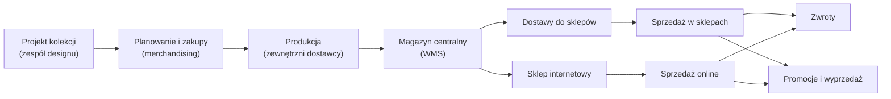

<!-- Generated by SpecStory, Markdown v2.1.0 -->

# 2026-11-09 13:43:31Z

<!-- VS Code Copilot IDE Session 7f09ca12-405b-40d2-aff4-e97475ea759e (2026-11-09 13:43:31Z) -->

_**User (2026-11-09 13:43:31Z)**_

dopisz mapę projektu - katalogi i ich przeznaczenie 

---

_**Agent (anthropic/Anthropic 2/claude-haiku-5-5)**_

<tool-use data-tool-type="read" data-tool-name="read_file"><details>
<summary>Tool use: **read_file**</summary>

Read `README.md`

**Input:**

- endLine: `300`
- filePath: `/home/teamsharq/Desktop/infoshare-silkycoders-data-science-ai-1/README.md`
- startLine: `1`

**Result:**

```
# infoshare-silkycoders-data-science-ai-1
```
</details></tool-use>

_**Agent (anthropic/Anthropic 2/claude-haiku-5-5)**_

<tool-use data-tool-type="read" data-tool-name="read_file"><details>
<summary>Tool use: **read_file**</summary>

Read `nordvik-opis-firmy.md`, lines 1 to 200

**Input:**

- endLine: `200`
- filePath: `/home/teamsharq/Desktop/infoshare-silkycoders-data-science-ai-1/docs/nordvik-opis-firmy.md`
- startLine: `1`

**Result:**

````
# Nordvik — opis firmy i modelu działania

## Spis treści

1. Profil firmy
2. Model biznesowy
3. Sklepy i kanały
4. Asortyment i produkt
5. Organizacja i odpowiedzialności
6. Rytm pracy firmy
7. Dane: źródła i hurtownia
8. Metryki
9. Data Science w Nordvik
10. Słownik pojęć
11. Założenia i źródła
 dasd
---

## 1. Profil firmy

| Obszar | Opis |
| --- | --- |
| Branża | Moda odzieżowa, sieć z własną ofertą (model *own brand*) |
| Sklepy stacjonarne | 5 |
| Sklep internetowy | 1 (kanał `ONLINE`) |
| Asortyment | Odzież damska i męska, akcesoria. Ok. 120 SKU (uproszczenie: prawdziwa sieć ma ich wielokrotnie więcej) |
| Sezony | `SS` (luty–lipiec) i `AW` (sierpień–styczeń), np. `AW26` |
| Waluta i VAT | PLN. VAT 23% na odzież |
| Historia danych | Sprzedaż od stycznia 2025. Stany magazynowe i zwroty za bieżący sezon |

---

## 2. Model biznesowy

### 2.1 Łańcuch wartości



### 2.2 Co firma zarabia i co ją kosztuje

- **Marża z własnego projektu.** Nordvik projektuje i zleca produkcję. Nie handluje cudzymi markami.
- **Zysk zależy od trzech rzeczy:**
  - trafności zakupu (ile z dostawy sprzedano przy pełnej cenie),
  - utrzymania ceny (ile oddano w rabatach),
  - kosztu zwrotów (szczególnie online).
- **Niesprzedany towar na koniec sezonu** = przecena lub wyprzedaż poniżej kosztu pozyskania marży.
- **Rozmiary.** Popyt skupia się na M i L. XS i XL to typowe ryzyko nadmiaru (*założenie zgodne z praktyką branży*).

### 2.3 Cykl życia produktu w sezonie

| Etap | Cena | Cel | Czas trwania (*założenie*) |
| --- | --- | --- | --- |
| Wejście do sprzed
… (output truncated)
````
</details></tool-use>

_**Agent (anthropic/Anthropic 2/claude-haiku-5-5)**_

<tool-use data-tool-type="write" data-tool-name="textEditGroup"><details>
<summary>Edit: **AGENTS.md**</summary>

@@ lines 78-78 @@

```


---

# Mapa projektu

| Ścieżka | Przeznaczenie |
| --- | --- |
| `AGENTS.md` | Instrukcje dla asystenta AI: rola, reguły pracy, zakres plików |
| `README.md` | Opis repozytorium (obecnie tylko tytuł) |
| `datasets/` | Dane do analiz: `daily_store_sales.csv` (sprzedaż dzienna w sklepach), `weekly_sales_lines.csv` (pozycje sprzedaży w ujęciu tygodniowym). Opis na podstawie nazw plików, bez weryfikacji zawartości |
| `docs/` | Dokumentacja projektu |
| `docs/nordvik-opis-firmy.md` | Opis firmy Nordvik, model działania, źródła danych, metryki |
| `docs/slownik-metryk.md` | Definicje metryk; sprawdzane przed każdym policzeniem metryki |
| `docs/sql-dokumentacja-i-przykłady.md` | Dokumentacja i przykłady SQL |
| `docs/jupyter-dokumentacja-i-przykłady.md` | Dokumentacja i przykłady pracy w Jupyter |
| `docs/analytics/` | Analizy w notebookach, m.in. `nordvik_churn_sales_analysis.ipynb` (analiza churnu i sprzedaży) |
| `sql/` | Zapytania SQL, m.in. `weekly_sales.sql` (sprzedaż tygodniowa) |
| `.github/` | Konfiguracja GitHub Copilot; `copilot-instructions.md` wskazuje na `AGENTS.md` |
| `zgloszenia/` | Przychodzące zgłoszenia biznesowe i materiały robocze. Poza zakresem analizy, chyba że użytkownik przekaże plik bezpośrednio |
| `notatki/` | Prywatne notatki użytkownika. Poza zakresem analizy |
```
</details></tool-use>

_**Agent (anthropic/Anthropic 2/claude-haiku-5-5)**_

Dopisałem mapę projektu na końcu `AGENTS.md#L1`. Opisy katalogów opierają się na nazwach plików i nagłówkach dokumentów; nie czytałem zawartości datasetów, SQL-i ani notebooka, więc ich opisy są oparte na nazwach.

Nie czytałem też katalogów `zgloszenia` i `notatki`, zgodnie z regułami w AGENTS.md. Ich opis pochodzi wyłącznie z reguł zapisanych w tym pliku.
