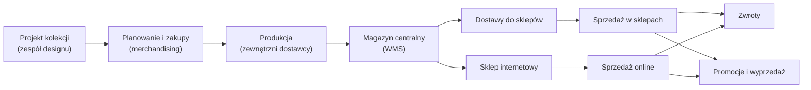

<!-- Generated by SpecStory, Markdown v2.1.0 -->

# 2026-11-10 11:09:11Z

<!-- VS Code Copilot IDE Session c6584381-0499-4caf-8549-c7b3399a9cd2 (2026-11-10 11:09:11Z) -->

_**User (2026-11-10 11:09:11Z)**_

co jest do zrobienia? sprawdz tez metryki i baze

---

_**Agent (copilot/claude-haiku-5.5)**_

Sprawdzę definicje metryk i instrukcje dotyczące bazy, a potem schemat RetailDW.   

_**Agent (copilot/claude-haiku-5.5)**_

<tool-use data-tool-type="read" data-tool-name="read_file"><details>
<summary>Tool use: **read_file**</summary>

Read `slownik-metryk.md`

**Input:**

- endLine: `400`
- filePath: `/home/teamsharq/Desktop/infoshare-silkycoders-data-science-ai-1/docs/slownik-metryk.md`
- startLine: `1`

**Result:**

```
# Słownik metryk Nordvik

Definicje używane w raportach sprzedaży, rentowności i zapasu. Kwoty podajemy w PLN, a udziały i dynamiki w procentach. Metryki liczymy dla wskazanego okresu i przekroju; jeśli w mianowniku jest zero, wynik wskaźnika pozostaje pusty.

## Sprzedaż

| Metryka | Definicja | Źródło |
| --- | --- | --- |
| **Sprzedaż brutto** | Wartość sprzedanego towaru z VAT, po rabacie. | `FactSales.GrossAmount` |
| **Rabat** | Kwota obniżki udzielonej na pozycjach sprzedaży. | `FactSales.DiscountAmount` |
| **Sprzedaż netto** | Sprzedaż brutto bez VAT; dla odzieży obowiązuje 23% VAT. | `FactSales.NetAmount` |
| **Sztuki** | Liczba sprzedanych sztuk. | `FactSales.Quantity` |
| **Wartość przed rabatem** | Wartość towaru według ceny sprzedaży przed obniżką, z VAT. | `SUM(FactSales.Quantity * FactSales.UnitPrice)` |
| **Stopa rabatu** | Rabat / wartość przed rabatem. | `FactSales` |
| **Średnia cena netto sztuki** | Sprzedaż netto / sztuki. | `FactSales` |
| **Udział kanału w sprzedaży** | Sprzedaż netto kanału / sprzedaż netto wszystkich kanałów w tym samym okresie. | `FactSales` + `DimStore.Channel` |
| **Zmiana sprzedaży tydzień do tygodnia** | (Sprzedaż netto bieżącego pełnego tygodnia − sprzedaż netto poprzedniego pełnego tygodnia) / sprzedaż netto poprzedniego tygodnia; oba tygodnie w tym samym przekroju. | `FactSales` + `DimDate` |
| **Sprzedaż po zwrotach netto** | Sprzedaż netto − wartość zwrotów bez VAT przyjętych w tym okresie. | `FactSales.NetAmount`, `FactReturns.ReturnAmount` |
| **Aktywne SKU** | Liczba różnych SKU sprzedanych w okresie. | `FactSales.ProductKey` |
| **Sztuki na aktywne SKU** | Sztuki / liczba aktywnych SKU. | `FactSales` |

W raportach zarządczych słowo **„sprzedaż”** bez doprecyzowania oznacza **sprzedaż netto**, przed odjęciem zwrotów. Sprzedaży brutto używamy, gdy pytanie dotyczy kwoty zapłaconej przez klienta.

Kanały to `ONLINE` i `STORE` z `DimStore.Channel`.

## Rentowność

| Metryka | Definicja | Źródło |
| --- | --- | ---
… (output truncated)
```
</details></tool-use>

_**Agent (copilot/claude-haiku-5.5)**_

<tool-use data-tool-type="read" data-tool-name="read_file"><details>
<summary>Tool use: **read_file**</summary>

Read `database.instructions.md`

**Input:**

- endLine: `200`
- filePath: `/home/teamsharq/Desktop/infoshare-silkycoders-data-science-ai-1/.github/instructions/database.instructions.md`
- startLine: `1`

**Result:**

```
---
description: "Use when querying, exploring schema, validating or modifying the RetailDW PostgreSQL database (schemas dw, reporting, src, stg, etl, ops), running pgsql tools, or writing migrations and seeds for retaildw. Covers connection profile, read-only default, schema checks, metric definitions and migration rules."
applyTo: "databases/**"
---
# Baza RetailDW (PostgreSQL)

## Połączenie
- Profil: `RetailDW` (id `E9FAC3AA-A4DB-4CA6-9CFD-B89E85C5E95E`), baza `retaildw`, `127.0.0.1:5433`.
- Hasła są tylko w `databases/RetailDW-postgres/.env`. Nie wpisuj ich do plików ani zapytań.
- Analizy wykonuj jako `retaildw_ro` (odczyt), jeśli to możliwe.
- Skrypt `retaildw.sh` nie ma prawa wykonania; uruchamiaj go przez `bash retaildw.sh <komenda>`.

## Schematy
- `src`: dane surowe (`sales_raw`, `inventory_raw`, `returns_raw`).
- `stg`: staging (`sales`, `inventory`, `returns`).
- `dw`: hurtownia (wymiary `dim_*`, fakty `fact_*`).
- `reporting`: widoki do raportów (`sales_daily`, `sales_weekly`, `margin_analysis`, `product_performance`, `stock_availability`, `store_scorecard`).
- `etl`: `load_log`, procedury `etl.load_*`. `ops`: `schema_migrations`.

## Zapytania
- Przed zapytaniem sprawdź schemat (`pgsql_db_context` albo `information_schema`). Nazw tabel i kolumn nie zgaduj.
- Przed policzeniem metryki sprawdź definicję w [docs/slownik-metryk.md](../../docs/slownik-metryk.md) i podaj źródło.
- „Sprzedaż” bez doprecyzowania = `net_amount` (netto przed zwrotami).
- Nie używaj `SELECT *`. Podawaj kolumny jawnie.
- Literały (kanał, sklep, daty, sezon) waliduj zapytaniem sprawdzającym.
- Duże wyniki eksportuj do pliku (`pgsql_export_query_results`), nie wczytuj ich do kontekstu.
- Zapytania zapisane do `.sql` mają nagłówek i sekcję `-- Notes:` zgodnie z [sql.instructions.md](sql.instructions.md).

## Modyfikacje
- Zmiany danych i schematu (`pgsql_modify`, `retaildw.sh seed`, `load`) wykonuj tylko po wyraźnym potwierdzeniu użytkownika.
- Nowa zmiana schematu = nowy plik `db/m
… (output truncated)
```
</details></tool-use>

_**Agent (copilot/claude-haiku-5.5)**_

<tool-use data-tool-type="read" data-tool-name="read_file"><details>
<summary>Tool use: **read_file**</summary>

Read `nordvik-opis-firmy.md`, lines 1 to 300

**Input:**

- endLine: `300`
- filePath: `/home/teamsharq/Desktop/infoshare-silkycoders-data-science-ai-1/docs/nordvik-opis-firmy.md`
- startLine: `1`

**Result:**

````
# Nordvik — opis firmy i modelu działania

## Spis treści

1. Profil firmy
2. Model biznesowy
3. Sklepy i kanały
4. Asortyment i produkt
5. Organizacja i odpowiedzialności
6. Rytm pracy firmy
7. Dane: źródła i hurtownia
8. Metryki
9. Data Science w Nordvik
10. Słownik pojęć
11. Założenia i źródła
 dasd
---

## 1. Profil firmy

| Obszar | Opis |
| --- | --- |
| Branża | Moda odzieżowa, sieć z własną ofertą (model *own brand*) |
| Sklepy stacjonarne | 5 |
| Sklep internetowy | 1 (kanał `ONLINE`) |
| Asortyment | Odzież damska i męska, akcesoria. Ok. 120 SKU (uproszczenie: prawdziwa sieć ma ich wielokrotnie więcej) |
| Sezony | `SS` (luty–lipiec) i `AW` (sierpień–styczeń), np. `AW26` |
| Waluta i VAT | PLN. VAT 23% na odzież |
| Historia danych | Sprzedaż od stycznia 2025. Stany magazynowe i zwroty za bieżący sezon |

---

## 2. Model biznesowy

### 2.1 Łańcuch wartości



### 2.2 Co firma zarabia i co ją kosztuje

- **Marża z własnego projektu.** Nordvik projektuje i zleca produkcję. Nie handluje cudzymi markami.
- **Zysk zależy od trzech rzeczy:**
  - trafności zakupu (ile z dostawy sprzedano przy pełnej cenie),
  - utrzymania ceny (ile oddano w rabatach),
  - kosztu zwrotów (szczególnie online).
- **Niesprzedany towar na koniec sezonu** = przecena lub wyprzedaż poniżej kosztu pozyskania marży.
- **Rozmiary.** Popyt skupia się na M i L. XS i XL to typowe ryzyko nadmiaru (*założenie zgodne z praktyką branży*).

### 2.3 Cykl życia produktu w sezonie

| Etap | Cena | Cel | Czas trwania (*założenie*) |
| --- | --- | --- | --- |
| Wejście do sprzed
… (output truncated)
````
</details></tool-use>

_**Agent (copilot/claude-haiku-5.5)**_

Słownik i opis firmy są przeczytane. Teraz sprawdzę schemat bazy (tylko odczyt). 

_**Agent (copilot/claude-haiku-5.5)**_

<tool-use data-tool-type="generic" data-tool-name="tool_search"><details>
<summary>Tool use: **tool_search**</summary>

**Input:**

- query: `pgsql query postgres connect list connection profiles describe schema`

**Result:**

```
["mcp_pgsql-tools_pgsql_list_connection_profiles","pgsql_list_connection_profiles","mcp_pgsql-tools_pgsql_connect","mcp_pgsql-tools_pgsql_list_databases","mcp_pgsql-tools_pgsql_db_context"]
```
</details></tool-use>

_**Agent (copilot/claude-haiku-5.5)**_

<tool-use data-tool-type="generic" data-tool-name="mcp_pgsql-tools_pgsql_list_connection_profiles"><details>
<summary>Tool use: **mcp_pgsql-tools_pgsql_list_connection_profiles**</summary>

Ran `pgsql_list_connection_profiles` 

**Result:**

```
{"profiles":[{"profileId":"E9FAC3AA-A4DB-4CA6-9CFD-B89E85C5E95E","profileName":"RetailDW","hostName":"127.0.0.1","defaultDatabase":"retaildw"}]}
```
</details></tool-use>

_**Agent (copilot/claude-haiku-5.5)**_

<tool-use data-tool-type="generic" data-tool-name="mcp_pgsql-tools_pgsql_connect"><details>
<summary>Tool use: **mcp_pgsql-tools_pgsql_connect**</summary>

Ran `pgsql_connect` 

**Input:**

- profileId: `E9FAC3AA-A4DB-4CA6-9CFD-B89E85C5E95E`

**Result:**

```
{"connectionId":"mcp://E9FAC3AA-A4DB-4CA6-9CFD-B89E85C5E95E/retaildw","success":true,"message":"Successfully connected to profile E9FAC3AA-A4DB-4CA6-9CFD-B89E85C5E95E"}
```
</details></tool-use>

_**Agent (copilot/claude-haiku-5.5)**_

<tool-use data-tool-type="generic" data-tool-name="mcp_pgsql-tools_pgsql_db_context"><details>
<summary>Tool use: **mcp_pgsql-tools_pgsql_db_context**</summary>

Ran `pgsql_db_context` 

**Input:**

- connectionId: `mcp://E9FAC3AA-A4DB-4CA6-9CFD-B89E85C5E95E/retaildw`
- objectType: `tables`

**Result:**

```
{"results":"-- Schema: dw\nCREATE TABLE \"dw\".\"dim_date\" (\n    date_key integer NOT NULL,\n    full_date date NOT NULL,\n    calendar_year smallint NOT NULL,\n    calendar_quarter smallint NOT NULL,\n    calendar_month smallint NOT NULL,\n    month_name character varying(20) NOT NULL,\n    year_month character varying(7) NOT NULL,\n    iso_year smallint NOT NULL,\n    iso_week smallint NOT NULL,\n    year_week character varying(8) NOT NULL,\n    day_of_week smallint NOT NULL,\n    day_name character varying(20) NOT NULL,\n    is_weekend boolean NOT NULL,\n    season character varying(10) NOT NULL,\n    CONSTRAINT pk_dim_date PRIMARY KEY (date_key)\n);\nCREATE TABLE \"dw\".\"dim_product\" (\n    product_key integer NOT NULL,\n    sku character varying(40) NOT NULL,\n    style_code character varying(20) NOT NULL,\n    style_name character varying(100) NOT NULL,\n    department character varying(20) NOT NULL,\n    category character varying(30) NOT NULL,\n    color character varying(20) NOT NULL,\n    size character varying(5) NOT NULL,\n    list_price numeric(10,2) NOT NULL,\n    unit_cost numeric(10,2) NOT NULL,\n    is_active boolean DEFAULT true NOT NULL,\n    CONSTRAINT pk_dim_product PRIMARY KEY (product_key)\n);\nCREATE TABLE \"dw\".\"dim_store\" (\n    store_key integer NOT NULL,\n    store_code character varying(20) NOT NULL,\n    store_name character varying(100) NOT NULL,\n    city character varying(50) NOT NULL,\n    region character varying(50) NOT NULL,\n    channel character varying(10) NOT NULL,\n    format character varying(20) NOT NULL,\n    sales_area_m2 integer,\n    opened_date date NOT NULL,\n    remodel_date date,\n    CONSTRAINT ck_dim_store_channel CHECK (channel::text = ANY (ARRAY['STORE'::character varying, 'ONLINE'::character varying]::text[])),\n    CONSTRAINT pk_dim_store PRIMARY KEY (store_key)\n);\nCREATE TABLE \"dw\".\"fact_inventory_daily\" (\n    inventory_key bigint NOT NULL,\n    date_key integer NOT NULL,\n    product_key integ
… (output truncated)
```
</details></tool-use>

_**Agent (copilot/claude-haiku-5.5)**_

<tool-use data-tool-type="read" data-tool-name="read_file"><details>
<summary>Tool use: **read_file**</summary>

Read `content.json`

**Input:**

- endLine: `300`
- filePath: `/home/teamsharq/.config/Code/User/workspaceStorage/216beb5f62e4569d77f7781835491675/GitHub.copilot-chat/chat-session-resources/c6584381-0499-4caf-8549-c7b3399a9cd2/toolu_01WopHySGybKL8SripM6SaUx__vscode-1794295442294/content.json`
- startLine: `1`

**Result:**

```
{
  "results": "-- Schema: dw\nCREATE TABLE \"dw\".\"dim_date\" (\n    date_key integer NOT NULL,\n    full_date date NOT NULL,\n    calendar_year smallint NOT NULL,\n    calendar_quarter smallint NOT NULL,\n    calendar_month smallint NOT NULL,\n    month_name character varying(20) NOT NULL,\n    year_month character varying(7) NOT NULL,\n    iso_year smallint NOT NULL,\n    iso_week smallint NOT NULL,\n    year_week character varying(8) NOT NULL,\n    day_of_week smallint NOT NULL,\n    day_name character varying(20) NOT NULL,\n    is_weekend boolean NOT NULL,\n    season character varying(10) NOT NULL,\n    CONSTRAINT pk_dim_date PRIMARY KEY (date_key)\n);\nCREATE TABLE \"dw\".\"dim_product\" (\n    product_key integer NOT NULL,\n    sku character varying(40) NOT NULL,\n    style_code character varying(20) NOT NULL,\n    style_name character varying(100) NOT NULL,\n    department character varying(20) NOT NULL,\n    category character varying(30) NOT NULL,\n    color character varying(20) NOT NULL,\n    size character varying(5) NOT NULL,\n    list_price numeric(10,2) NOT NULL,\n    unit_cost numeric(10,2) NOT NULL,\n    is_active boolean DEFAULT true NOT NULL,\n    CONSTRAINT pk_dim_product PRIMARY KEY (product_key)\n);\nCREATE TABLE \"dw\".\"dim_store\" (\n    store_key integer NOT NULL,\n    store_code character varying(20) NOT NULL,\n    store_name character varying(100) NOT NULL,\n    city character varying(50) NOT NULL,\n    region character varying(50) NOT NULL,\n    channel character varying(10) NOT NULL,\n    format character varying(20) NOT NULL,\n    sales_area_m2 integer,\n    opened_date date NOT NULL,\n    remodel_date date,\n    CONSTRAINT ck_dim_store_channel CHECK (channel::text = ANY (ARRAY['STORE'::character varying, 'ONLINE'::character varying]::text[])),\n    CONSTRAINT pk_dim_store PRIMARY KEY (store_key)\n);\nCREATE TABLE \"dw\".\"fact_inventory_daily\" (\n    inventory_key bigint NOT NULL,\n    date_key integer NOT NULL,\n    product_key i
… (output truncated)
```
</details></tool-use>

_**Agent (copilot/claude-haiku-5.5)**_

<tool-use data-tool-type="read" data-tool-name="read_file"><details>
<summary>Tool use: **read_file**</summary>

Read `schema.json`

**Input:**

- endLine: `200`
- filePath: `/home/teamsharq/.config/Code/User/workspaceStorage/216beb5f62e4569d77f7781835491675/GitHub.copilot-chat/chat-session-resources/c6584381-0499-4caf-8549-c7b3399a9cd2/toolu_01WopHySGybKL8SripM6SaUx__vscode-1794295442294/schema.json`
- startLine: `1`

**Result:**

```
{"type":"object","properties":{"results":{"type":"string"},"errorMessage":{"type":"null"}},"required":["results","errorMessage"]}
```
</details></tool-use>

_**Agent (copilot/claude-haiku-5.5)**_

Odpowiedź ze schematu została ucięta. Pobiorę listę tabel i widoków bezpośrednio zapytaniem. 

_**Agent (copilot/claude-haiku-5.5)**_

<tool-use data-tool-type="generic" data-tool-name="tool_search"><details>
<summary>Tool use: **tool_search**</summary>

**Input:**

- query: `pgsql query read-only SQL execute`

**Result:**

```
["mcp_pgsql-tools_pgsql_query","mcp_pgsql-tools_pgsql_export_query_results","mcp_pgsql-tools_pgsql_modify","pgsql_query","mcp_pgsql-tools_pgsql_open_script"]
```
</details></tool-use>

_**Agent (copilot/claude-haiku-5.5)**_

<tool-use data-tool-type="generic" data-tool-name="mcp_pgsql-tools_pgsql_query"><details>
<summary>Tool use: **mcp_pgsql-tools_pgsql_query**</summary>

Ran `pgsql_query` 

**Input:**

- connectionId: `mcp://E9FAC3AA-A4DB-4CA6-9CFD-B89E85C5E95E/retaildw`
- query:

```
SELECT table_schema, table_name, table_type
FROM information_schema.tables
WHERE table_schema IN ('src', 'stg', 'dw', 'reporting', 'etl', 'ops')
ORDER BY table_schema, table_name;
```

- queryDescription: `Lista tabel i widoków w schematach RetailDW, do oceny zakresu danych przed analizą BC-01.`
- queryName: `list_retaildw_objects`
- validationQueries: `[]`

**Result:**

```
{"results":"table_schema,table_name,table_type\ndw,dim_date,BASE TABLE\ndw,dim_product,BASE TABLE\ndw,dim_store,BASE TABLE\ndw,fact_inventory_daily,BASE TABLE\ndw,fact_returns,BASE TABLE\ndw,fact_sales,BASE TABLE\netl,load_log,BASE TABLE\nops,schema_migrations,BASE TABLE\nreporting,margin_analysis,VIEW\nreporting,product_performance,VIEW\nreporting,sales_daily,VIEW\nreporting,sales_weekly,VIEW\nreporting,stock_availability,VIEW\nreporting,store_scorecard,VIEW\nsrc,inventory_raw,BASE TABLE\nsrc,returns_raw,BASE TABLE\nsrc,sales_raw,BASE TABLE\nstg,inventory,BASE TABLE\nstg,returns,BASE TABLE\nstg,sales,BASE TABLE","errorMessage":null}
```
</details></tool-use>

_**Agent (copilot/claude-haiku-5.5)**_

Schemat jest zgodny z opisem. Sprawdzę kolumny kluczowych tabel, definicję widoku tygodniowego (pułapka `Year` vs `IsoYear`) oraz zakres dat sprzedaży. 

_**Agent (copilot/claude-haiku-5.5)**_

<tool-use data-tool-type="generic" data-tool-name="mcp_pgsql-tools_pgsql_query"><details>
<summary>Tool use: **mcp_pgsql-tools_pgsql_query**</summary>

Ran `pgsql_query` 

**Input:**

- connectionId: `mcp://E9FAC3AA-A4DB-4CA6-9CFD-B89E85C5E95E/retaildw`
- query:

```
SELECT 'view_def' AS item, pg_get_viewdef('reporting.sales_weekly'::regclass, true) AS detail
UNION ALL
SELECT 'fact_sales_cols', string_agg(column_name || ':' || data_type, ', ' ORDER BY ordinal_position)
FROM information_schema.columns
WHERE table_schema = 'dw' AND table_name = 'fact_sales'
UNION ALL
SELECT 'fact_sales_range', MIN(d.full_date)::text || ' .. ' || MAX(d.full_date)::text || ' rows=' || COUNT(*)::text
FROM dw.fact_sales f
JOIN dw.dim_date d ON d.date_key = f.date_key
UNION ALL
SELECT 'fact_inventory_range', MIN(d.full_date)::text || ' .. ' || MAX(d.full_date)::text || ' rows=' || COUNT(*)::text
FROM dw.fact_inventory_daily i
JOIN dw.dim_date d ON d.date_key = i.date_key;
```

- queryDescription: `Definicja widoku sales_weekly, kolumny fact_sales oraz zakres dat w sprzedaży i stanach.`
- queryName: `check_weekly_view_and_ranges`
- validationQueries: `[]`

**Result:**

```
{"results":"item,detail\nview_def, SELECT d.iso_year,\n    d.iso_week,\n    d.year_week,\n    min(d.full_date) AS week_start,\n    max(d.full_date) AS week_end,\n    st.channel,\n    st.region,\n    p.department,\n    p.category,\n    sum(f.quantity) AS units,\n    count(DISTINCT f.transaction_no) AS transactions,\n    sum(f.gross_amount) AS gross_amount,\n    sum(f.discount_amount) AS discount_amount,\n    sum(f.net_amount) AS net_amount,\n    sum(f.quantity::numeric * f.unit_cost) AS cost_amount\n   FROM dw.fact_sales f\n     JOIN dw.dim_date d ON d.date_key = f.date_key\n     JOIN dw.dim_store st ON st.store_key = f.store_key\n     JOIN dw.dim_product p ON p.product_key = f.product_key\n  GROUP BY d.iso_year, d.iso_week, d.year_week, st.channel, st.region, p.department, p.category;\nfact_sales_cols,sales_key:bigint, date_key:integer, product_key:integer, store_key:integer, transaction_no:character varying, line_number:integer, quantity:integer, unit_price:numeric, discount_amount:numeric, gross_amount:numeric, net_amount:numeric, unit_cost:numeric, load_id:integer\nfact_sales_range,2025-01-01 .. 2026-09-20 rows=192333\nfact_inventory_range,2026-06-01 .. 2026-09-20 rows=82956","errorMessage":null}
```
</details></tool-use>

_**Agent (copilot/claude-haiku-5.5)**_

Widok `reporting.sales_weekly` nie zawiera `style_code` ani `store_key`, więc BC-01 (StyleCode × lokalizacja) musi czytać `dw.fact_sales` bezpośrednio. Ostatni krok to kontrola relacji kwot z definicji słownika. 

_**Agent (copilot/claude-haiku-5.5)**_

<tool-use data-tool-type="generic" data-tool-name="mcp_pgsql-tools_pgsql_query"><details>
<summary>Tool use: **mcp_pgsql-tools_pgsql_query**</summary>

Ran `pgsql_query` 

**Input:**

- connectionId: `mcp://E9FAC3AA-A4DB-4CA6-9CFD-B89E85C5E95E/retaildw`
- query:

```
SELECT
    COUNT(*) AS rows_total,
    COUNT(*) FILTER (WHERE ABS(f.gross_amount - (f.quantity * f.unit_price - f.discount_amount)) > 0.01) AS rows_gross_mismatch,
    COUNT(*) FILTER (WHERE ABS(f.net_amount - f.gross_amount / 1.23) > 0.01) AS rows_net_mismatch,
    COUNT(*) FILTER (WHERE f.quantity <= 0) AS rows_qty_nonpositive,
    COUNT(*) FILTER (WHERE f.unit_cost IS NULL) AS rows_null_cost
FROM dw.fact_sales f;
```

- queryDescription: `Sprawdzenie zgodności relacji kwot w fact_sales z definicjami w słowniku metryk (gross = qty*price - rabat, net = gross/1.23).`
- queryName: `check_fact_sales_amount_relations`
- validationQueries: `[]`

**Result:**

```
{"results":"rows_total,rows_gross_mismatch,rows_net_mismatch,rows_qty_nonpositive,rows_null_cost\n192333,0,0,0,0","errorMessage":null}
```
</details></tool-use>

_**Agent (copilot/claude-haiku-5.5)**_

## BC-01: prognoza popytu, co zostało do zrobienia

**Uwaga o dacie:** dzisiaj jest 2026-11-10, a origin w zleceniu to 2026-09-21. Prognoza na W39–W42 jest więc już nieaktualna, a dane w bazie kończą się 2026-09-20. Zanim zaczniemy, trzeba ustalić, czy chodzi o backtest na tych tygodniach, czy o nowy origin (np. W46–W49) i nowe dane.

### Pytanie biznesowe i decyzja
- Ile sztuk wysłać do lokalizacji (5 sklepów + online) w najbliższych 4 tygodniach, na poziomie `StyleCode × lokalizacja`, dla top 20 modeli.
- Czy prognoza pokonuje dzisiejszą praktykę (średnia z 4 tygodni + korekta „na oko") i z jakim błędem.

### Metryki (sprawdzone ze słownikiem)

| Metryka | Definicja | Źródło | Status |
| --- | --- | --- | --- |
| Sztuki | `SUM(Quantity)` | `docs/slownik-metryk.md`, sekcja Sprzedaż | Zgodna z briefem |
| Sprzedaż netto | `SUM(NetAmount)`, domyślna miara „sprzedaży" | słownik, Sprzedaż | Zgodna |
| Tydzień | ISO: `IsoYear` + `IsoWeek`, nie `Year` | słownik, Kalendarz | Zgodna |
| Rabat / stopa rabatu | rabat / `SUM(Quantity × UnitPrice)` | słownik, Sprzedaż | Zgodna |
| WAPE | suma błędów bezwzględnych / suma sprzedaży rzeczywistej | zlecenie (BC-01) | **Brak w słowniku** |
| Obciążenie (bias) | (suma prognoz − suma rzeczywistych) / suma rzeczywistych | zlecenie (BC-01) | **Brak w słowniku** |

Do potwierdzenia: czy dodać WAPE i bias do `docs/slownik-metryk.md`. Do tego czasu definicje z briefu są jedynym źródłem.

### Źródła danych
- **Parquet** `bc01` (źródło wskazane w zleceniu): `dim_date`, `dim_store`, `dim_product`, `merch_plan`, `fact_sales`, `fact_inventory_daily`. Nie czytałem tych plików.
- **RetailDW** (`dw.*`): zawiera wymiary i fakty, ale **nie ma `merch_plan`**, co potwierdza brief.

### Wyniki sprawdzenia bazy RetailDW
- Schemat: `dw` (wymiary i fakty), `reporting` (widoki), `src`, `stg`, `etl`, `ops` są zgodne z dokumentacją.
- `dw.fact_sales`: 192 333 wiersze, 2025-01-01 do 2026-09-20. Zgodne z zakresem w briefie.
- `dw.fact_inventory_daily`: 82 956 wierszy, od **2026-06-01**. Brief mówi o stanach od **sierpnia 2026**. Rozbieżność do wyjaśnienia.
- Relacje kwot: `gross = qty × price − rabat` i `net = gross / 1,23` zgodne dla wszystkich wierszy. Brak ujemnych ilości i pustych kosztów.
- Widok `reporting.sales_weekly` grupuje po `region` i `channel`, bez `style_code` ani sklepu. **Nie nadaje się do BC-01.** Trzeba czytać `dw.fact_sales` z join do `dw.dim_product` i `dw.dim_store`.

### Kroki analizy (po ustaleniu origin)
1. Audyt danych: zakres, duplikaty, zerowa sprzedaż vs brak towaru (cenzurowanie), nowe kolekcje.
2. Zbudować panel tygodniowy `StyleCode × lokalizacja`, ISO-tydzień.
3. Wybrać top 20 modeli z 8 tygodni przed origin.
4. Baseline B1 (średnia 4 ostatnich pełnych tygodni) i porównanie z modelem szeregów czasowych oraz modelem globalnym.
5. Backtest rolling-origin. Osobno WAPE dla sumy 4 tygodni i per horyzont.
6. Zimny start: modele z ≤ 6 tygodniami historii.
7. Przedziały prognozy, obciążenie, flagi ostrożności.
8. Wynik: notebook (sekcje z briefu) i raport biznesowy na 1 stronę.

### Założenia do potwierdzenia
- Brak akcji rabatowych w horyzoncie (potwierdzone przez Pricing wg zlecenia). Nie mamy kalendarza promocji w danych.
- Źródło prawdy: Parquet z `datasets` czy RetailDW. Czy mają te same wiersze, nie sprawdzałem.
- Połączenie z bazą użyło domyślnego użytkownika profilu `RetailDW`. Wytyczne wskazują rolę `retaildw_ro`. Nie potwierdziłem, której roli użyłem.

### Pytania otwarte
1. Czy analiza ma dotyczyć W39–W42 jako backtest, czy nowego origin? Jeśli nowy, skąd dane po 2026-09-20?
2. Skąd pochodzi różnica w datach stanów (2026-06-01 w bazie, sierpień w briefie)?
3. Czy WAPE i bias dodajemy do słownika metryk?
4. Czy w zadaniu obowiązuje też wariant Airflow (`zgloszenia/Analizy/BC-01-prognoza-popytu--airflow.md`), czy tylko notebook?

_**Agent (copilot/claude-haiku-5.5)**_

<tool-use data-tool-type="task" data-tool-name="manage_todo_list"><details>
<summary>Tool use: **manage_todo_list**</summary>

Created 3 todos
</details></tool-use>
