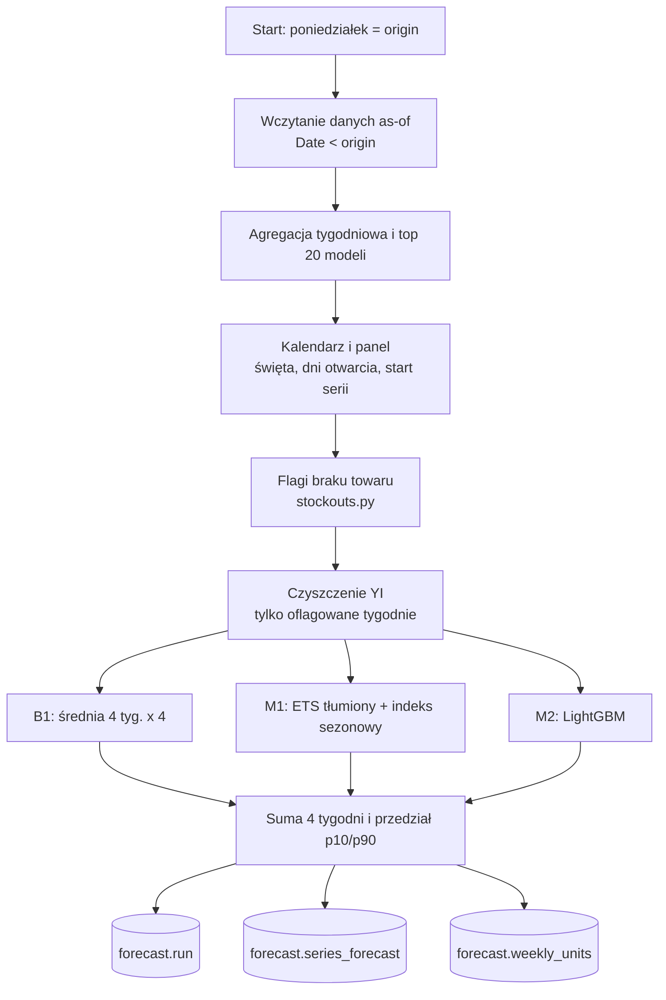
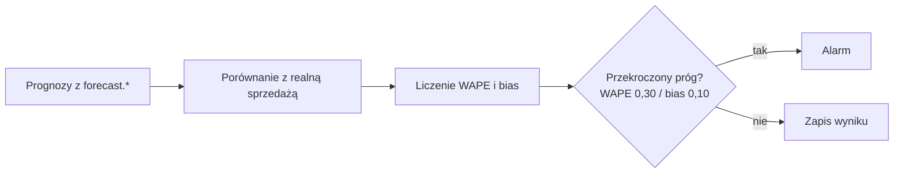

<!-- Generated by SpecStory, Markdown v2.1.0 -->

# 2026-11-10 12:08:15Z

<!-- VS Code Copilot IDE Session cc268619-534b-46c1-897e-ef54cbf51cca (2026-11-10 12:08:15Z) -->

_**User (2026-11-10 12:08:15Z)**_

jak będzie skonstruowany cały proces - DAG, jaki będzie flow (+diagramy), co znaczają skróty (rozwiń), co jest juz zrobione a co nie 

---

_**Agent (copilot/claude-haiku-5.5)**_

<tool-use data-tool-type="generic" data-tool-name="list_dir"><details>
<summary>Tool use: **list_dir**</summary>

Read `dags`

**Input:**

- path: `/home/teamsharq/Desktop/infoshare-silkycoders-data-science-ai-1/airflow/dags`

**Result:**

```
.gitkeep
```
</details></tool-use>

_**Agent (copilot/claude-haiku-5.5)**_

<tool-use data-tool-type="generic" data-tool-name="list_dir"><details>
<summary>Tool use: **list_dir**</summary>

Read `bc01`

**Input:**

- path: `/home/teamsharq/Desktop/infoshare-silkycoders-data-science-ai-1/airflow/src/bc01`

**Result:**

```
__init__.py
__pycache__/
baseline.py
calendar.py
data.py
features.py
m1.py
m2.py
panel.py
stockouts.py
```
</details></tool-use>

_**Agent (copilot/claude-haiku-5.5)**_

<tool-use data-tool-type="read" data-tool-name="read_file"><details>
<summary>Tool use: **read_file**</summary>

Read `bc01.yaml`

**Input:**

- endLine: `60`
- filePath: `/home/teamsharq/Desktop/infoshare-silkycoders-data-science-ai-1/airflow/config/bc01.yaml`
- startLine: `1`

**Result:**

```
# Konfiguracja prognozy BC-01. Każda zmiana podnosi config_version i trafia do forecast.run.
config_version: 1

# Ziarno dla wszystkiego, co losowe (zgodnie z notebookiem: SEED = 20260921).
seed: 20260921

# Horyzont: tygodnie t+1..t+4 od poniedziałku-origin; wynik to też suma 4 tygodni.
horizon_weeks: 4

# Zakres prognozy: top N modeli wg sprzedaży w lookback tygodniach przed origin, × lokalizacja.
top_n_models: 20
top_n_lookback_weeks: 8

# Założenie zlecenia: brak nowych akcji rabatowych w prognozowanym okresie.
promo_assumption: no_new_promotions

# Przedział niepewności (p10–p90).
forecast_interval: 0.80

# Progi alarmu monitoringu. Wartości testowe, do zmiany po testach.
wape_alarm_threshold: 0.30
bias_alarm_threshold: 0.10
```
</details></tool-use>

_**Agent (copilot/claude-haiku-5.5)**_

<tool-use data-tool-type="search" data-tool-name="grep_search"><details>
<summary>Tool use: **grep_search**</summary>

Searched for regex `^def |^class |TODO|NotImplemented` (`**/airflow/src/bc01/m2.py`), 2 results

**Input:**

- includePattern: `airflow/src/bc01/m2.py`
- isRegexp: `true`
- query: `^def |^class |TODO|NotImplemented`

**Result:**

```
Found 2 matches in 1 file for "^def |^class |TODO|NotImplemented"

airflow/src/bc01/m2.py
35:def build_rows(ctx: Context, Y: np.ndarray, F: np.ndarray, YI: np.ndarray,
42:def fit_predict(rows: pd.DataFrame, origin_t: int, n_series: int,
```
</details></tool-use>

_**Agent (copilot/claude-haiku-5.5)**_

## Proces BC-01 w Airflow: plan, flow i status

Stan na podstawie `airflow/HANDOFF.md` oraz sprawdzenia katalogów. Katalog `airflow/dags` zawiera tylko `.gitkeep`, więc żaden DAG jeszcze nie istnieje.

### Cel
Cotygodniowa prognoza popytu z analizy BC-01: prognoza w każdy poniedziałek, zapis historii do `forecast.*` w RetailDW, monitoring dokładności i alarm.

### Dwa DAG-i (planowane)

| DAG | Harmonogram | Co robi |
| --- | --- | --- |
| `bc01_prognoza_tygodniowa` | poniedziałki | Wczytuje dane sprzed originu, liczy modele, zapisuje wynik wraz z wersją konfiguracji i kodu |
| `bc01_monitoring_dokladnosci` | po prognozie | Porównuje dawne prognozy z realną sprzedażą (WAPE, bias) względem B1, uruchamia alarm |

Dodatkowo planowany jest backfill historyczny: ręczne uruchomienie z parametrem daty.

### Flow prognozy tygodniowej



### Flow monitoringu



Zasada as-of: model widzi tylko dane z tygodni przed originem. Test kontraktu to sprawdza.

### Rozwinięcie skrótów

| Skrót | Znaczenie |
| --- | --- |
| DAG | Directed Acyclic Graph: graf zadań Airflow bez cykli |
| RetailDW | Hurtownia danych sieci Nordvik w PostgreSQL |
| as-of | Dane wyłącznie sprzed wskazanego momentu (originu) |
| origin | Poniedziałek, od którego liczony jest horyzont prognozy |
| horyzont | Liczba tygodni prognozy: 4 (t+1..t+4) |
| top 20 | 20 modeli o największej sprzedaży w ostatnich 8 tygodniach przed originem, razem z lokalizacją |
| WAPE | Weighted Absolute Percentage Error: ważony średni błąd bezwzględny w procentach |
| bias | Obciążenie: średni kierunek błędu (przeszacowanie dodatnie, niedoszacowanie ujemne) |
| p10 / p90 | 10. i 90. percentyl: granice przedziału 80% |
| B1 | Baseline 1: średnia z 4 tygodni pomnożona przez 4 |
| M1 | Model 1: wygładzanie wykładnicze ETS (tłumione) z indeksem sezonowym |
| ETS | Exponential Smoothing: wygładzanie wykładnicze (błąd, trend, sezonowość) |
| M2 | Model 2: LightGBM (gradient boosting) |
| M3 | Nie rozwijam: brak definicji w dokumentach, które przeczytałem |
| B2 | Nie rozwijam: brak definicji w dokumentach, które przeczytałem |
| MT, CT | Agregaty z `features.py`, nierozwinięte. Definicja jest w notebooku |
| YI | Oznaczenie w notebooku, nierozwinięte. Definicja jest w notebooku |
| SKU | Nie używany w tym procesie |

Notebook nie był czytany w tej odpowiedzi, więc nie podaję definicji, których nie mogę potwierdzić (M3, B2, MT, CT, YI).

### Status

**Zrobione (wg handoffu, sprawdzone testami):**
- Baza: migracja V026 (schemat `forecast`: `run`, `series_forecast`, `weekly_units`), rola i baza `airflow`.
- Infrastruktura: `airflow/compose.yaml` (Airflow 3.4.0, metadane w PostgreSQL, kontener `healthy`), `airflow/config/bc01.yaml`, wzorzec `.env`.
- Kod wspólny: `data.py` (as-of), `baseline.py` (B1), `calendar.py`, `panel.py`, `stockouts.py`, `features.py`, `m1.py`.
- Testy: kontrakt as-of i B1, warstwa danych, cechy, M1 (zgodność z cache w tolerancji 1e-6).
- Zgodność B1 i flag z `analizy/bc01-prognoza-popytu/prognoza-W39-W42-top20.csv` dla origin 2026-09-21.

**Do zrobienia:**
- M2 (LightGBM), analogi, B2, M3. W `airflow/src/bc01/m2.py` są funkcje `build_rows` i `fit_predict`, ale handoff ich nie oznacza jako gotowe i nie ma dla nich testów. Status do potwierdzenia.
- Reguły zer (sekcja 5 notebooka), przedziały i wyniki (sekcja 7).
- Oba DAG-i, backfill.
- Weryfikacja fazy 5: `list-import-errors`, zgodność z CSV dla całego potoku, powtarzalność dwóch uruchomień, test alarmu.
- Migracja V027 z widokiem w `reporting`: wymaga potwierdzenia.

**Otwarte pytania (do użytkownika):**
1. Czy DAG ma publikować przedziały tygodniowe, czy tylko sumę 4 tygodni (obecnie tylko suma).
2. Czy dodać V027 z widokiem w `reporting`.
3. Progi alarmu: obecne WAPE 0,30 i bias 0,10 są testowe.
4. Zależność `statsmodels` (M1) jest w venv testowym, ale nie w `_PIP_ADDITIONAL_REQUIREMENTS` kontenera. Trzeba ją dodać z przypiętą wersją przed DAG-ami.

Kolejny krok według handoffu: dokończyć M2 w `bc01`, potem porównać B1 z CSV referencyjnym.

_**Agent (copilot/claude-haiku-5.5)**_

<tool-use data-tool-type="task" data-tool-name="manage_todo_list"><details>
<summary>Tool use: **manage_todo_list**</summary>

Created 4 todos
</details></tool-use>

---

_**User (2026-11-10 12:16:58Z)**_

wytłumacz mi to z grubsza jak dla kogoś kto jest senior dev, ale nie jest data scientistem - skanowalnie, czytelnie w punktach, możesz używać analogii

---

_**Agent (copilot/claude-haiku-5.5)**_

<tool-use data-tool-type="read" data-tool-name="read_file"><details>
<summary>Tool use: **read_file**</summary>

Read `m2.py`

**Input:**

- endLine: `120`
- filePath: `/home/teamsharq/Desktop/infoshare-silkycoders-data-science-ai-1/airflow/src/bc01/m2.py`
- startLine: `1`

**Result:**

```
"""M2 BC-01: LightGBM (Poisson) na wierszach cech origin x seria x horyzont.

Konfiguracja zamrożona wg notebooka (wybór: ablacja grup cech i siatka parametrów na originach strojeniowych).
Źródło wartości: klucz (cechy, parametry) w cache notebooka, który ma prognozy dla wszystkich originów:
analizy/bc01-prognoza-popytu/cache/m2_runs_v1.pkl (cache nie jest w repo; test weryfikuje zgodność).
"""

from __future__ import annotations

import numpy as np
import pandas as pd

from bc01.features import Context, feature_rows

# Kolejność zgodna z kluczem cache (33 cechy minus grupa "krk").
M2_FEATURES: tuple[str, ...] = (
    "h", "lag1", "lag2", "lag3", "lag4", "m4", "m8", "m13", "trend",
    "cat", "store", "coll", "is_basic", "age_series", "age_launch",
    "mdl_m4", "mdl_last", "share8", "cat_mom",
    "open_days", "moving", "wk_easter", "wk_corpus", "wk_black_friday", "wk_xmas_eve",
    "trading_sunday", "holidays_monsat", "iso_week", "lag52", "m8_ly", "disc",
)

M2_PARAMS: dict = dict(
    objective="poisson", learning_rate=0.05, num_leaves=15, min_child_samples=30,
    subsample=0.8, subsample_freq=1, colsample_bytree=0.8, reg_lambda=1.0,
    n_estimators=600, random_state=20260921, n_jobs=4, verbose=-1,
    deterministic=True, force_row_wise=True,
)

CAT_FEATURES: tuple[str, ...] = ("cat", "store", "coll")
FIRST_ORIGIN_INDEX = 8  # origin od tygodnia 8 (jak w notebooku: range(8, T + 1))


def build_rows(ctx: Context, Y: np.ndarray, F: np.ndarray, YI: np.ndarray,
               MT: np.ndarray, CT: np.ndarray, T: int) -> pd.DataFrame:
    """Wiersze cech dla wszystkich originów t = 8..T (włącznie), jak ROWS w notebooku."""
    parts = [feature_rows(ctx, t, Y, F, YI, MT, CT) for t in range(FIRST_ORIGIN_INDEX, T + 1)]
    return pd.concat(parts, ignore_index=True)


def fit_predict(rows: pd.DataFrame, origin_t: int, n_series: int,
                feats=M2_FEATURES, params: dict | None = None) -> np.ndarray:
    """Trening na wierszach znanych przed originem, predykcja w
… (output truncated)
```
</details></tool-use>

_**Agent (copilot/claude-haiku-5.5)**_

## M2 w BC-01: co to jest, z grubsza

**Problem biznesowy**
- Chcemy wiedzieć, ile sztuk każdego z 20 najlepiej sprzedających się modeli sprzeda się w każdym sklepie w ciągu 4 najbliższych tygodni.
- Prognoza jest liczona co poniedziałek i zapisywana w bazie.

**Analogia**
- Stary model (M1) to prosta formuła: wygładzona średnia z trendem i sezonowością. Jak prognoza pogody z samej historii temperatur.
- M2 to model uczący się na wielu cechach naraz, jak regresja z setkami zmiennych. Patrzy też na dzień tygodnia, święta, dni otwarcia, wiek modelu, kategorię. Wcześniej uczył się na tabelce, a teraz odpowiada na pytanie „co będzie w tym tygodniu, biorąc pod uwagę te warunki”.

**Jak działa M2 (w skrócie)**
- **Wiersze cech:** każda para (origin, seria, horyzont) to jeden wiersz. Origin to poniedziałek, od którego liczymy prognozę. Seria to model × sklep. Horyzont to tydzień 1 do 4 w przód.
- **Trening:** model uczy się wyłącznie na tygodniach, które były znane przed originem. Brak wycieku przyszłości, jak w backteście, który nie może zaglądać w jutro.
- **Wyłączenia z treningu:** tygodnie, w których towaru zabrakło (flaga braku towaru), są pomijane. Sprzedaż zero przy pustej półce nie mówi nic o popycie.
- **Predykcja:** model dostaje cechy z originu i zwraca liczbę sztuk na każdy z 4 tygodni.
- **Typ rozkładu:** `objective="poisson"` oznacza, że model zakłada liczbę sztuk jako 

## M2 w BC-01: co to jest, z grubsza

**Problem biznesowy**
- Chcemy wiedzieć, ile sztuk każdego z 20 najlepiej sprzedających się modeli sprzeda się w każdym sklepie w ciągu 4 najbliższych tygodni.
- Prognoza jest liczona co poniedziałek i zapisywana w bazie.

**Analogia**
- Stary model (M1) to prosta formuła: wygładzona średnia z trendem i sezonowością. Jak prognoza pogody z samej historii temperatur.
- M2 to model uczący się na wielu cechach naraz, jak regresja z setkami zmiennych. Patrzy też na dzień tygodnia, święta, dni otwarcia, wiek modelu, kategorię. Wcześniej uczył się na tabelce, a teraz odpowiada na pytanie „co będzie w tym tygodniu, biorąc pod uwagę te warunki”.

**Jak działa M2 (w skrócie)**
- **Wiersze cech:** każda para (origin, seria, horyzont) to jeden wiersz. Origin to poniedziałek, od którego liczymy prognozę. Seria to model × sklep. Horyzont to tydzień 1 do 4 w przód.
- **Trening:** model uczy się wyłącznie na tygodniach, które były znane przed originem. Brak wycieku przyszłości, jak w backteście, który nie może zaglądać w jutro.
- **Wyłączenia z treningu:** tygodnie, w których towaru zabrakło (flaga braku towaru), są pomijane. Sprzedaż zero przy pustej półce nie mówi nic o popycie.
- **Predykcja:** model dostaje cechy z originu i zwraca liczbę sztuk na każdy z 4 tygodni.
- **Typ rozkładu:** `objective="poisson"` oznacza, że model zakłada liczbę sztuk jako zdarzenia zliczane. Dla danych typu „ile sztuk sprzedano” to naturalny wybór.
- **Powtarzalność:** ustawione ziarno losowości, `deterministic=True`. Te same dane dają ten sam wynik. Jest to wymóg z HANDOFF (dwa uruchomienia tego samego tygodnia muszą dać identyczny wynik).

**Co zostało zamrożone z notebooka**
- Lista 30 cech () i parametry () pochodzą z eksperymentu w notebooku (wybór cech i siatka parametrów).
- Źródłem prawdy jest cache notebooka `m2_runs_v1.pkl`. Nie jest w repozytorium, więc test porównuje wynik z nim, jeśli plik jest dostępny.
- Analogia: to jak przepisanie configu z działającego środowiska. Trzeba zrobić dokładnie tę samą konfigurację, inaczej wyniki będą inne.

**Status: WIP, commit, nie gotowe**
- Ostatni commit: `WIP: BC-01 M2 LightGBM (cache test still failing: disc feature)`.
- Kod M2 jest napisany, ale test zgodności z cache **nie przechodzi**.
- Podejrzany jest jeden z wymienionych w liście cech, `disc`. Wynik modelu różni się od notebooka, więc prawdopodobnie cecha `disc` jest liczona inaczej niż w notebooku. To hipoteza do sprawdzenia, nie potwierdzony fakt.
- Analogia: dwa silniki o tej samej konfiguracji dają inny moment obrotowy. Najpierw porównuje się wejścia, dopiero potem wynik.

**Co dalej**
- Znaleźć, dlaczego `disc` różni się od notebooka. Porównać wartości cechy wiersz po wierszu z cache.
- Po zgodności z cache: porównać końcowy B1 z `analizy/bc01-prognoza-popytu/prognoza-W39-W42-top20.csv`.
- Dopiero potem DAG-i.

**Słownik (krótko)**
- **origin:** poniedziałek startu prognozy.
- **horyzont h:** który z 4 tygodni prognozy (1 do 4).
- **cecha (feature):** zmienna wejściowa dla modelu, np. sprzedaż tydzień wcześniej (`lag1`), święta, wiek modelu.
- **flaga braku towaru:** tydzień, w którym sprzedaż mogła być zaniżona przez brak towaru.
- **cache:** zapisany wynik z notebooka, używany jako wzorzec do testów.
