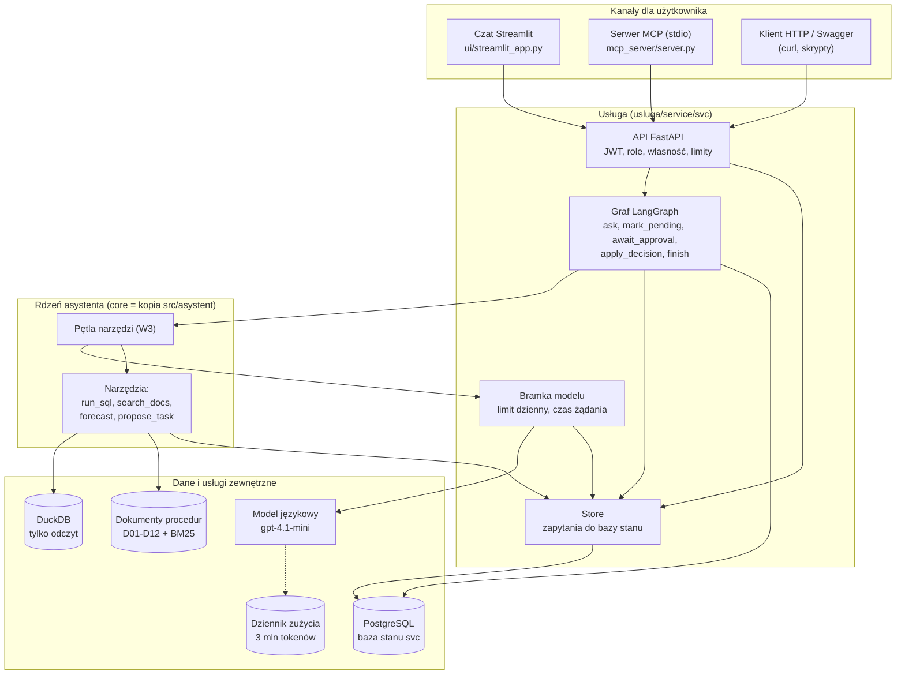
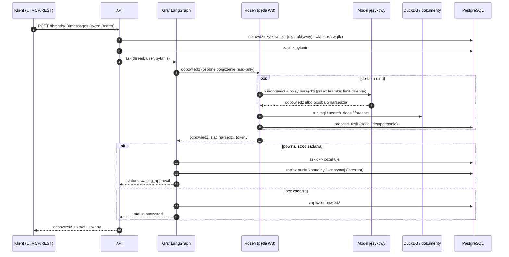
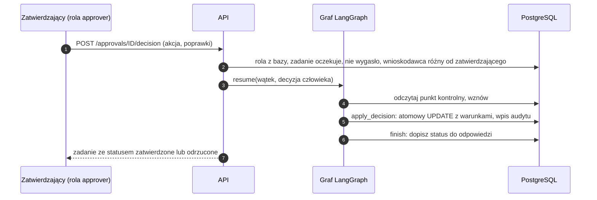
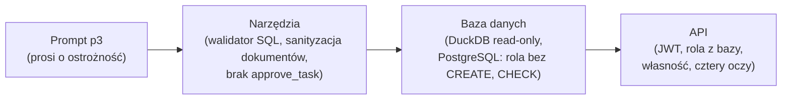
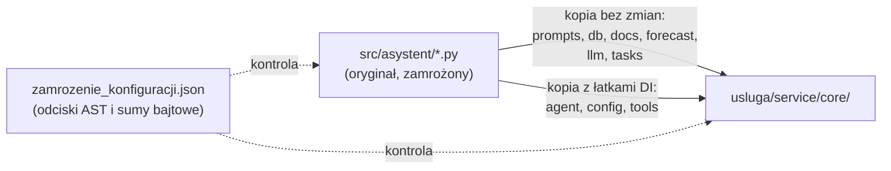

# Architektura: asystent analityczny Nordvik (BC-09)

Dokument opisuje całość w skali „z lotu ptaka": z czego się składa, jak płynie pytanie, gdzie są zabezpieczenia i co wolno zmieniać. Szczegóły: [rdzen-asystenta.md](rdzen-asystenta.md) i [usluga-struktura.md](usluga-struktura.md).

## 1. Cel i dwa etapy

Asystent odpowiada pracownikom Nordvik (kierownicy sklepów, analitycy, zakupy) na pytania o **liczby** (sprzedaż, zwroty, zapasy, prognoza) i **procedury** (dokumenty). Może też **przygotować szkic zadania**, ale zadanie zatwierdza człowiek. Powstał w dwóch etapach:

| Etap | Co powstało | Gdzie | Status |
| --- | --- | --- | --- |
| 1. Analiza | Rdzeń asystenta, porównanie wariantów W1-W4, oceniacz, testy bezpieczeństwa, zamrożenie konfiguracji | `src/`, `bc09-asystent-analityczny.ipynb`, `wyniki/` | zamrożony |
| 2. Usługa | Wielodostępna usługa: logowanie, role, trwałe rozmowy, zatwierdzanie zadań, REST, czat, MCP | `usluga/` | gotowa (pilotaż, środowisko szkoleniowe) |

Usługa **nie poprawia jakości odpowiedzi**: jakość to wynik etapu 1. Usługa dokłada bezpieczne udostępnienie tego samego rdzenia wielu osobom.

## 2. Widok warstwowy



Zasady podziału:

- **Interfejsy (UI, MCP) wołają wyłącznie API.** Nie mają dostępu do bazy ani do modelu (test statyczny sprawdza brak importów `psycopg`, `duckdb`, `openai` w UI).
- **Rdzeń nie wie o użytkownikach.** Dostaje wstrzyknięte: funkcję rozmowy z modelem (bramka z limitem), magazyn szkiców zadań i połączenie z danymi.
- **Dane dla asystenta i stan usługi to dwie osobne bazy** z osobnymi uprawnieniami: DuckDB (tylko odczyt, dane Nordvik) i PostgreSQL (stan: użytkownicy, rozmowy, zadania, audyt).

## 3. Jak płynie pytanie



Zatwierdzanie (osobne żądanie innego użytkownika, po godzinach, a nawet po restarcie usługi):



## 4. Warstwy obrony (kto czego pilnuje)

Najważniejsza zasada: **żadna kontrola nie zależy wyłącznie od promptu.** Prompt kieruje zachowaniem modelu, ale gwarancje dają mechanizmy poniżej.



| Ryzyko | Gdzie jest zablokowane (twarda kontrola) | Warstwa |
| --- | --- | --- |
| Model zmienia dane lub konfigurację | połączenie DuckDB `read_only` z wyłączonym dostępem do plików; walidator SQL (jedna instrukcja `SELECT`, lista schematów i funkcji) | narzędzie + baza |
| Model zatwierdza zadanie | w rejestrze narzędzi nie ma `approve_task`; decyzję zapisuje kod usługi z danymi z API | narzędzie + API |
| Człowiek zatwierdza własne zadanie | sprawdzenie w API (403) i `CHECK (approver_id <> requester_id)` w bazie | API + baza |
| Polecenie ukryte w dokumencie | sanityzacja regułowa (kwarantanna) i traktowanie treści jako danych; **nie wychwytuje przeformułowań** (znane ograniczenie) | narzędzie + proces |
| Koszt wymknął się spod kontroli | limity rdzenia (rundy, wywołania, tokeny na pytanie), limit dzienny na użytkownika, twardy limit łączny w dzienniku zużycia | rdzeń + usługa |
| Cudze dane | własność sprawdzana w tym samym zapytaniu co odczyt; cudze i nieistniejące zwracają 404 | API + baza |
| Wyciek sekretów | sekrety tylko w zmiennych środowiskowych i `.env` poza repozytorium; błędy ogólne z `request_id` | konfiguracja |

## 5. Rdzeń zamrożony i kopia w usłudze

Przed testem końcowym zapisano konfigurację (`wyniki/zamrozenie_konfiguracji.json`: model, wersja promptu, limity, odciski plików). Zmiana kodu rdzenia po zamrożeniu **unieważnia wyniki testu**, więc obowiązują zasady:



- **Łatki wstrzykiwania zależności (DI)** są trzy i tylko takie: `agent.py` (parametr `chat` zamiast globalnego klienta modelu), `tools.py` (wstrzykiwany magazyn zadań i współdzielone, niezmienne indeksy dokumentów i prognozy), `config.py` (ścieżki liczone od innego katalogu).
- **Komentarze są dozwolone, zmiana kodu nie.** Dlatego integralność sprawdza **odcisk AST** (struktura kodu bez komentarzy), a nie suma bajtowa. Sumy bajtowe w pliku zamrożenia zostają jako zapis historyczny.
- Kontrole: `python analizy/bc09-asystent-analityczny/_build/freeze_final.py verify` (oryginał) oraz test `test_core_copy_differs_from_frozen_core_only_by_declared_di_patches` (kopia w usłudze).
- Kopię w `core/` po zmianie komentarzy w oryginale odświeża się kopiowaniem plików bez łatek i ręcznym przeniesieniem komentarzy do trzech plików z łatkami.

## 6. Kluczowe decyzje projektowe

| Decyzja | Uzasadnienie | Gdzie szczegóły |
| --- | --- | --- |
| Wariant W3 (agent z czterema narzędziami), prompt p3 | W3 wypadł najlepiej w pomiarach na zbiorze dev; W4 (pod-agenci) był gorszy w jakości, wykonywał dwa razy więcej kroków i był ponad dwa razy wolniejszy | notebook analizy, sekcja 6 |
| Dane w DuckDB tylko do odczytu | prostota, silnik sam odrzuca zapisy; adapter do PostgreSQL odłożony | [../usluga/ADR.md](../usluga/ADR.md) |
| LangGraph z punktami kontrolnymi w PostgreSQL | gotowa semantyka wstrzymania i wznowienia po restarcie; uczciwa ocena: własny automat stanów też by wystarczył | ADR, sekcja 2 |
| Jeden szkic zadania na pytanie | decyzja człowieka dotyczy jednego, jasno opisanego zadania; prostszy graf | ADR, sekcja 5 |
| Interfejsy tylko przez API | jedno miejsce kontroli dostępu; UI i MCP nie mogą obejść reguł | ADR, sekcja 1 |
| Rola z bazy, nie z tokenu | zmiana roli i dezaktywacja działają od razu | ADR, sekcja 3 |
| Limity w kilku miejscach | model może się mylić, a koszt jest realny: rdzeń, użytkownik i całość mają osobne limity | [usluga-struktura.md](usluga-struktura.md) |

## 7. Struktura katalogów

```text
analizy/bc09-asystent-analityczny/
├── bc09-asystent-analityczny.ipynb   notebook analizy (etap 1)
├── raport-biznesowy.md               wnioski dla biznesu
├── src/
│   ├── asystent/                     rdzeń (zamrożony): narzędzia, prompty, pętla, limity, warianty
│   └── ocena/                        runner, oceniacz, testy bezpieczeństwa, specyfikacje pytań
├── cache/                            baza DuckDB, dziennik zużycia, cache prognozy (generowane)
├── wyniki/                           surowe odpowiedzi, wyniki testów, rekord zamrożenia
├── _build/                           skrypty budowy notebooka i uruchamiania wariantów
├── docs/                             ta dokumentacja
└── usluga/                           etap 2
    ├── bc09-usluga.ipynb, README.md, ADR.md, RUNBOOK.md, raport-wdrozenia.md
    ├── wyniki/                       wyniki regresji przez REST
    └── service/
        ├── core/                     kopia rdzenia + 3 łatki DI
        ├── svc/                      API, graf, magazyn stanu, auth, bramka, administracja
        ├── ui/                       czat Streamlit
        ├── mcp_server/               serwer MCP
        ├── db/                       migracje SQL, skrypty bazy
        └── tests/                    25 testów + regresja + pomocniki
```

## 8. Znane ograniczenia (świadome)

- Środowisko szkoleniowe: bez TLS i SSO, pojedyncza instancja, brak kopii zapasowych bazy stanu, brak blokady po serii błędnych logowań, brak odwołania pojedynczego tokenu.
- Sanityzacja dokumentów regułowa: przeformułowane polecenie ją omija (atak A17 w testach; A05 to ablacja z wyłączoną sanityzacją, która pokazuje, co jest bez niej). Obrona przez zarządzanie dokumentami i przegląd nowych dokumentów.
- Faza 9 (ocena zbioru testowego i ślepa ocena 20 odpowiedzi) wstrzymana do decyzji zleceniodawcy.
- Dane syntetyczne; decyzja o wysyłaniu danych firmy do zewnętrznego dostawcy modelu należy do zleceniodawcy.
