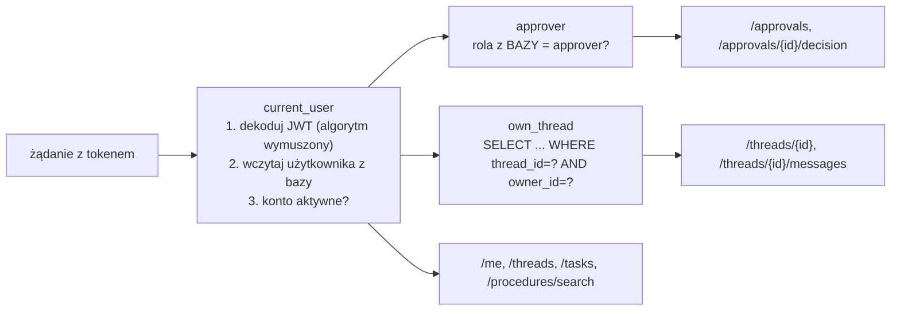
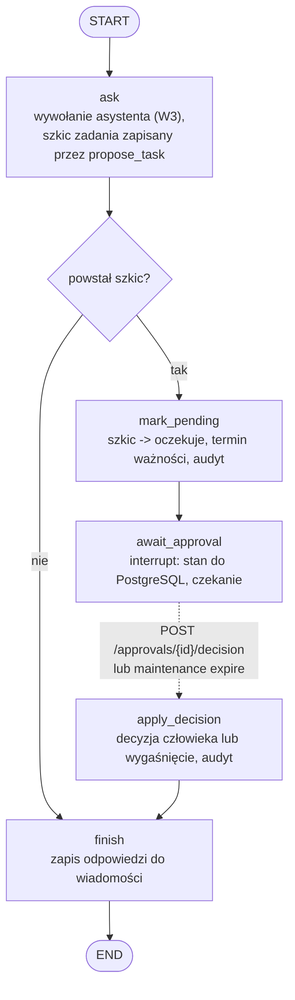
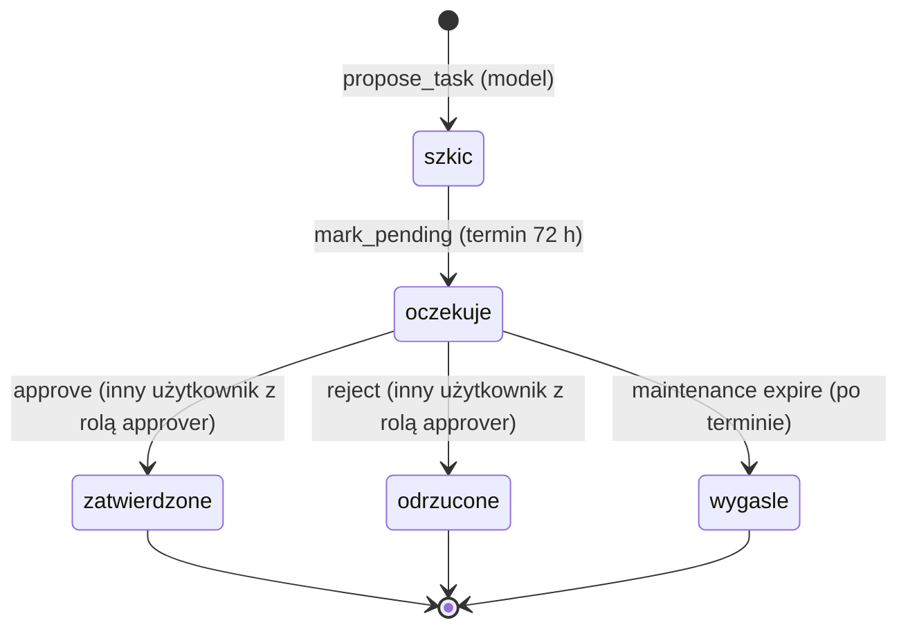
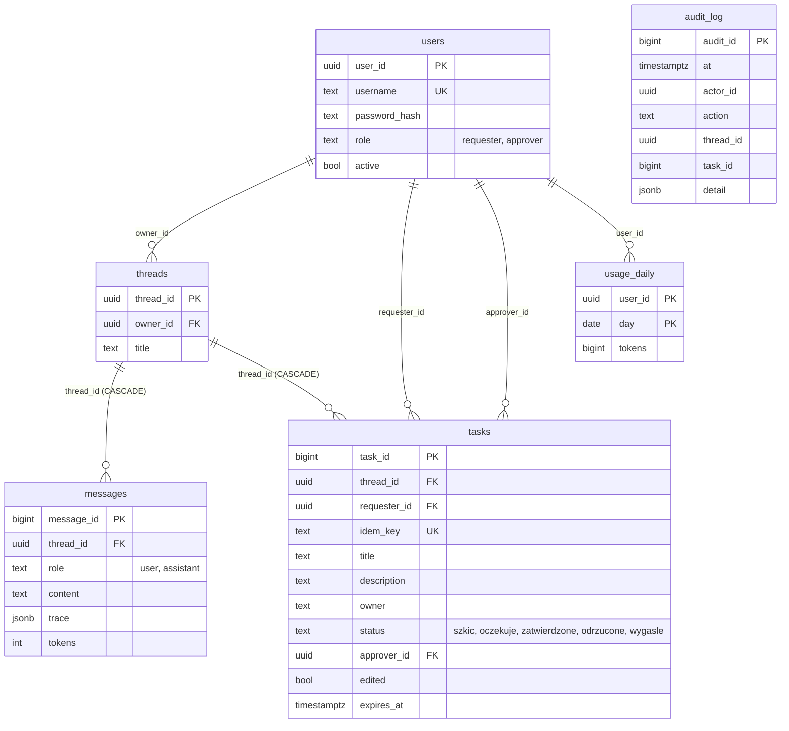
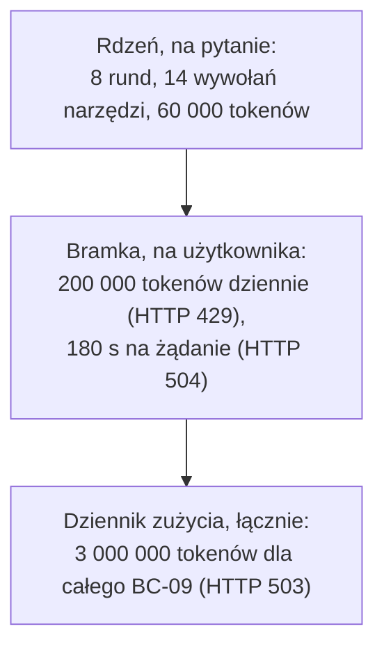

# Usługa: struktura i działanie (`usluga/service`)

Usługa udostępnia zamrożony rdzeń wielu użytkownikom. Dokłada cztery rzeczy: **tożsamość i role**, **trwały stan rozmów**, **zatwierdzanie zadań przez człowieka (także po restarcie)** oraz **limity kosztu na użytkownika**. Ogólny obraz: [architektura.md](architektura.md). Decyzje i model zagrożeń: [../usluga/ADR.md](../usluga/ADR.md).

## 1. Moduły

| Moduł | Odpowiedzialność | Zależy od |
| --- | --- | --- |
| `svc/main.py` | punkt wejścia ASGI (`uvicorn svc.main:app`), konfiguracja logów | `api` |
| `svc/api.py` | endpointy REST, zależności uwierzytelniania i własności, mapowanie błędów na kody HTTP, `request_id` | `auth`, `graph`, `store`, `schemas`, `gateway` |
| `svc/schemas.py` | kontrakt REST (Pydantic, `extra=forbid`, limity długości) | - |
| `svc/auth.py` | hasła PBKDF2-SHA256, tokeny JWT HS256 | PyJWT |
| `svc/config.py` | ustawienia ze zmiennych środowiskowych i pliku `.env` | - |
| `svc/store.py` | wszystkie zapytania do bazy stanu (jedna funkcja = jedno zapytanie) i adapter `PgTaskStore` | psycopg |
| `svc/graph.py` | graf LangGraph (`Engine`): pytanie, wstrzymanie, decyzja, odpowiedź | `core`, `store`, `gateway` |
| `svc/gateway.py` | bramka modelu: limit dzienny na użytkownika i czas żądania | `core.llm` |
| `svc/admin.py` | polecenia administracyjne (CLI) | `store`, `auth` |
| `svc/maintenance.py` | wygaszanie zatwierdzeń i retencja punktów kontrolnych (CLI) | `graph`, `store` |
| `core/` | kopia zamrożonego rdzenia z trzema łatkami wstrzykiwania zależności | DuckDB, model językowy |
| `ui/streamlit_app.py` | czat i widok zatwierdzeń; woła tylko API | httpx |
| `mcp_server/server.py` | serwer MCP (stdio); woła tylko API | httpx, mcp |
| `db/migrations/001_state.sql`, `db/*.sh`, `db/cleanup_test_data.sql` | schemat stanu, zakładanie i usuwanie bazy, czyszczenie danych testowych | PostgreSQL |

Zależności mają jeden kierunek: interfejsy → API → graf → rdzeń. `store` jest używany przez API i graf; rdzeń nie zna ani `store`, ani `api`.

## 2. Konfiguracja

Wszystko ze zmiennych środowiskowych; plik `service/.env` (poza repozytorium) jest wczytywany, ale nie nadpisuje zmiennych już ustawionych w środowisku. Wzór: `service/.env.example`.

| Zmienna | Domyślnie | Znaczenie |
| --- | --- | --- |
| `BC09_STATE_HOST`, `BC09_STATE_PORT`, `BC09_STATE_DB` | `127.0.0.1`, `5433`, `retaildw_bc09_state` | gdzie jest baza stanu |
| `BC09_STATE_SVC_PASSWORD` | wymagana | hasło roli `bc09_svc` (rola usługi, tylko DML) |
| `BC09_STATE_OWNER_PASSWORD` | wymagana (dla `admin setup`) | hasło roli właściciela schematu (migracje, tabele punktów kontrolnych) |
| `BC09_JWT_SECRET` | wymagana | sekret podpisu tokenów |
| `BC09_TOKEN_TTL_MIN` | `60` | ważność tokenu |
| `BC09_DAILY_TOKEN_LIMIT` | `200000` | dzienny limit tokenów **na użytkownika** (taki sam dla każdego) |
| `BC09_MAX_QUESTION_CHARS` | `1000` | maksymalna długość pytania (HTTP 413) |
| `BC09_APPROVAL_TTL_HOURS` | `72` | ważność oczekującego zatwierdzenia |
| `BC09_REQUEST_TIMEOUT_S` | `180` | limit czasu żądania do modelu |
| `OPENAI_API_KEY` | wymagana do pytań | klucz modelu (czytany przez rdzeń, tylko ze środowiska) |
| `BC09_API_URL`, `BC09_API_TOKEN` | `http://127.0.0.1:8000`, brak | dla UI i serwera MCP |
| `BC09_SEED_PW_ALA/BARTEK/CELINA`, `BC09_NEW_USER_PASSWORD` | brak | hasła dla `admin seed-users` i `admin create-user` |

Brak wymaganej zmiennej kończy start czytelnym komunikatem („Brak zmiennej środowiskowej …; patrz .env.example").

## 3. Punkty końcowe REST

Specyfikacja interaktywna: `GET /docs` (Swagger, przycisk Authorize) i `GET /openapi.json`.

| Metoda i ścieżka | Kto | Działanie | Typowe kody |
| --- | --- | --- | --- |
| `GET /health` | każdy | `ok` lub `degraded` (baza stanu niedostępna) | 200, 503 |
| `POST /auth/token` | każdy | logowanie (formularz `username`, `password`), zwraca token Bearer | 200, 401 |
| `GET /me` | zalogowany | login i rola | 200, 401 |
| `POST /threads` | zalogowany | nowy wątek (opcjonalny tytuł do 120 znaków) | 201, 422 |
| `GET /threads` | zalogowany | własne wątki (do 100, od najnowszych) | 200 |
| `GET /threads/{id}` | właściciel | wątek, wiadomości i zadanie oczekujące | 200, 404 |
| `POST /threads/{id}/messages` | właściciel | zadaje pytanie asystentowi | 200, 404, 409, 413, 422, 429, 503, 504 |
| `GET /tasks`, `GET /tasks/{id}` | autor zadania (lista); autor lub zatwierdzający (szczegóły) | zadania | 200, 404 |
| `GET /approvals` | `approver` | cudze zadania oczekujące i nie wygasłe | 200, 403 |
| `POST /approvals/{id}/decision` | `approver` | `approve` lub `reject` z opcjonalnymi poprawkami `title`, `description`, `owner` | 200, 403, 404, 409, 410 |
| `GET /procedures/search?q=` | zalogowany | wyszukiwanie dokumentów (bez modelu językowego) | 200 |

Znaczenie kodów:

| Kod | Kiedy |
| --- | --- |
| 401 | brak, błędny, wygasły lub podrobiony token; konto nieaktywne; błędny login lub hasło |
| 403 | brak roli `approver`; próba zatwierdzenia własnego zadania |
| 404 | cudzy lub nieistniejący wątek/zadanie (celowo nieodróżnialne); zadanie nie czeka na decyzję (np. drugie kliknięcie) |
| 409 | wątek czeka na zatwierdzenie (zadaj pytanie w nowym wątku); zadanie rozpatrzone równolegle |
| 410 | termin zatwierdzenia minął |
| 413 | pytanie dłuższe niż `BC09_MAX_QUESTION_CHARS` |
| 422 | naruszenie schematu (np. pytanie powyżej 2000 znaków, pole spoza kontraktu) |
| 429 | wyczerpany dzienny limit tokenów użytkownika |
| 503 | wyczerpany łączny limit tokenów modelu (cały pilotaż) |
| 504 | przekroczony czas żądania |
| 500 | błąd wewnętrzny; odpowiedź ogólna z `request_id`, szczegóły tylko w logach serwera |

Każda odpowiedź ma nagłówek `X-Request-ID`; w logach jest wiersz `rid=... METODA ŚCIEŻKA -> KOD czas` (bez treści i nagłówków).

## 4. Zależności API (jak działa kontrola dostępu)

Rola jest brana **z bazy przy każdym żądaniu**, nie z tokenu: token ze zmienioną rolą nic nie daje, a dezaktywacja konta działa natychmiast.

## 5. Graf LangGraph (`svc/graph.py`)

Zasady, dla których graf wygląda właśnie tak (sprawdzone w zainstalowanej wersji LangGraph 1.2.20):

- **Węzeł po wznowieniu startuje od początku.** Dlatego `await_approval` **nie ma skutków ubocznych przed `interrupt`** (tylko odczyt zadania), a skutki uboczne (zapis szkicu, decyzja) są w osobnych, idempotentnych węzłach.
- **Idempotencja szkicu**: klucz `sha256(thread_id | message_id)` jest `UNIQUE` w tabeli `tasks`; ponowne wykonanie nie tworzy drugiego szkicu. Drugi szkic w tym samym pytaniu jest odrzucany jako błąd narzędzia (`OneDraftPerQuestion`), więc **na pytanie przypada najwyżej jedno zadanie**.
- **Decyzję wykonuje kod usługi** (`apply_decision` + `Store.decide`) z danymi z API (kto zatwierdza, jakie poprawki), nie model. Model nie ma żadnego narzędzia zatwierdzającego.
- **Stan grafu** (`State`): `thread_id`, `user_id`, `message_id`, `question`, `answer`, `trace`, `tokens`, `task_id`, `decision`, `final`. Punkty kontrolne zapisuje `PostgresSaver` w tabelach schematu `svc`.
- **Izolacja żądań**: każde `ask` otwiera własne połączenie DuckDB `read_only` i własny `Toolbox`; indeks dokumentów i prognoza (niezmienne) są współdzielone, aby nie budować ich przy każdym pytaniu.

## 6. Automat stanów zadania

Przejście `oczekuje → zatwierdzone/odrzucone` to **jedno atomowe `UPDATE`** z warunkami w `WHERE` (`status='oczekuje'`, `requester_id <> approver_id`, `expires_at > now()`). Dwie równoległe decyzje: pierwsza zmienia wiersz, druga nie znajduje wiersza (404 lub 409). Poprawki zatwierdzającego (`title`, `description`, `owner`) są stosowane tym samym zapytaniem, a flaga `edited` zostaje `true`.

## 7. Model danych stanu (PostgreSQL, schemat `svc`)

Niezmienniki wymuszane **w bazie** (działają nawet przy obejściu API): `CHECK four_eyes (approver_id IS NULL OR approver_id <> requester_id)`, `CHECK decided_has_approver` (zatwierdzone i odrzucone zadanie ma zatwierdzającego), listy dozwolonych wartości `role`, `status`, limity długości pól, `UNIQUE idem_key`.

Dodatkowo `PostgresSaver` tworzy tabele punktów kontrolnych (`checkpoints`, `checkpoint_blobs`, `checkpoint_writes` i pomocnicze) tą samą rolą właściciela przy `admin setup`. Rola usługi `bc09_svc` ma wyłącznie `SELECT/INSERT/UPDATE/DELETE` (bez `CREATE` i `DROP`); test sprawdza, że próba utworzenia lub usunięcia obiektu kończy się odmową.

## 8. Audyt

Tabela `audit_log` zapisuje: `login`, `login_failed`, `ask` (narzędzia i tokeny), `task_pending`, `task_approve`, `task_reject` (z poprawkami w `detail.edits`), `task_expired` oraz `self_approval_denied`. Zapytania audytowe („kto zatwierdził co"): [../usluga/RUNBOOK.md](../usluga/RUNBOOK.md).

## 9. Limity kosztu (trzy poziomy)

- Dzienny limit jest liczony z tabeli `usage_daily` (upsert dodaje tokeny atomowo) i sprawdzany **przed każdym wywołaniem modelu**; limit jest „miękki" o jedno wywołanie modelu (wywołanie rozpoczęte tuż pod limitem może go przekroczyć).
- Domyślnie **taki sam dla każdego użytkownika**; zmiana przez zmienną środowiskową (limity per osoba nie są zaimplementowane).

## 10. Wymiana modelu na fałszywy w testach

`Engine` i `create_app` przyjmują opcjonalny `base_chat`: funkcję o interfejsie `core.llm.chat`. Produkcyjnie jest pusta (używany jest prawdziwy model przez bramkę), w testach podstawiany jest deterministyczny model testowy (`tests/conftest.py::fake_chat`). To jedyny punkt, w którym testy podmieniają zachowanie; reszta (baza stanu, DuckDB, serwer HTTP, MCP, Streamlit) jest prawdziwa. Szczegóły: [testy-automatyczne.md](testy-automatyczne.md).

## 11. Jak dodać endpoint (lista kontrolna)

1. Dodaj schemat odpowiedzi i wejścia w `schemas.py` (dziedziczy po `Strict`, limity długości).
2. Wybierz zależność: `current_user`, `approver` albo `own_thread` (nie sprawdzaj własności ręcznie po odczycie: cudzy i nieistniejący obiekt mają dawać ten sam 404).
3. Zapytania wyłącznie przez nową funkcję w `Store`; reguły dostępu w warunku `WHERE`, nie w kodzie po odczycie.
4. Zapis zdarzenia w `audit_log` dla każdej akcji zmieniającej stan.
5. Test w `tests/test_api.py` z dwoma użytkownikami (dostęp do cudzych danych) i przypadkiem błędnym.
6. **Nie** wołaj bazy ani modelu z `ui/` i `mcp_server/`: tylko przez API.
