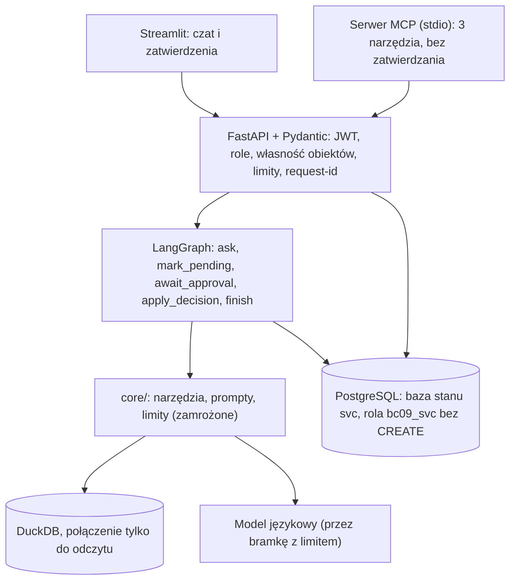

# ADR: asystent analityczny BC-09 jako usługa

**Status:** przyjęta 2026-11-10 (środowisko szkoleniowe). **Kontekst:** zamrożony prototyp (jeden użytkownik, terminal) ma obsłużyć wielu użytkowników z rolami, trwałym stanem rozmów,
zatwierdzaniem zadań przez inną osobę w czasie (także po restarcie) i trzema wejściami (REST, czat, MCP) o tych samych zabezpieczeniach. **Twarde ograniczenie:** dane tylko do odczytu, zapis (zadanie) wyłącznie po zatwierdzeniu przez człowieka; model nie może zatwierdzać.

## 1. Warstwy

| Warstwa | Odpowiedzialność | Decyzja |
| --- | --- | --- |
| `core/` | narzędzia (`run_sql`, `search_docs`, `forecast`, `propose_task`), prompty p3, limity | kopia zamrożonego rdzenia; zmiany tylko wstrzykiwanie zależności (3 pliki, test sum kontrolnych) |
| `svc/graph.py` | kolejność kroków, trwałe wstrzymanie | LangGraph + `PostgresSaver` |
| `svc/api.py` | uwierzytelnianie, autoryzacja na poziomie obiektu, limity, audyt | FastAPI, endpointy synchroniczne (graf jest synchroniczny; pula wątków, bez blokowania pętli zdarzeń) |
| `ui/`, `mcp_server/` | prezentacja i wejście zewnętrzne | wołają **tylko API**; brak dostępu do bazy i modelu |

## 2. Test uzasadnienia LangGraph (z kosztem)

Co musiałaby dopisać własna pętla, żeby spełnić trzy wymagania:

| Wymaganie | Własna pętla | LangGraph | Ocena |
| --- | --- | --- | --- |
| (1) wstrzymanie w środku kroku na dowolnie długo i wznowienie po restarcie przez innego użytkownika | serializacja stanu kroku do bazy, tabela oczekujących, mechanizm wznowienia dokładnie raz, testy awarii | `interrupt` + checkpointer; test: proces kończy się `os._exit` w oczekiwaniu, nowy proces wznawia, 1 zadanie | **uzasadnia** (najsilniejszy argument) |
| (2) trwały wątek rozmowy | tabele `threads`/`messages` | te same tabele + punkty kontrolne | **nie uzasadnia**: wątki i wiadomości i tak są w naszej bazie niezależnie od frameworka |
| (3) strumieniowanie zdarzeń | własne kolejki | wbudowane | **odpada**: nie użyte (zasada: najpierw zmierzyć korzyść, nie mierzono) |

**Uczciwa ocena:** w tym projekcie pętla modelu kończy się **przed** wstrzymaniem (wstrzymanie trzyma tylko identyfikator zadania i odpowiedź), więc automat stanów w tabeli `tasks` (`szkic -> oczekuje -> zatwierdzone/odrzucone/wygasle`) dałby większość efektu bez frameworka.
Zostaje przy LangGraph z jednego powodu: **gotowa, przetestowana semantyka wznowienia i trwałości punktów kontrolnych** (mniej własnego kodu krytycznego dla bezpieczeństwa). To decyzja o umiarkowanym uzasadnieniu, możliwa do odwrócenia.
**Koszt:** zależności (`langgraph`, `langgraph-checkpoint-postgres`, `langchain-core`, `langgraph-prebuilt`), 5 tabel punktów kontrolnych tworzonych rolą właściciela, nowe reguły (węzeł startuje od początku po wznowieniu: wstrzymanie w osobnym węźle bez skutków ubocznych; skutki uboczne idempotentne),
wersjonowanie punktów kontrolnych przy zmianie grafu, retencja (zadanie `maintenance retention`), zmienne API między wersjami (sprawdzone w zainstalowanej 1.2.20, nie w dokumentacji).

## 3. Macierz uprawnień

| Zasób | Wnioskodawca (`requester`) | Zatwierdzający (`approver`) |
| --- | --- | --- |
| Własne wątki i wiadomości | odczyt, zapis | odczyt, zapis (jak wnioskodawca) |
| Cudze wątki | brak (404) | brak (404) |
| Własne zadania | odczyt | odczyt |
| Cudze zadania | brak (404) | odczyt tylko `oczekuje` (nie własne) lub rozpatrzone przez siebie |
| Lista zatwierdzeń | 403 | tylko cudze, `oczekuje`, nie wygasłe |
| Decyzja (zatwierdź/popraw/odrzuć) | 403 | tak, **nie własnego zadania** (API 403 + `CHECK` w bazie) |
| `/procedures/search` | tak | tak |

Rola jest czytana **z bazy** przy każdym żądaniu (nie z tokenu): zmiana roli lub dezaktywacja działa od razu. Wątek jest odnajdywany jednym zapytaniem z własnością (`WHERE thread_id=? AND owner_id=?`): cudzy i nieistniejący wątek są nieodróżnialne.

## 4. Model danych stanu (`db/migrations/001_state.sql`)

`users` (hash hasła PBKDF2-SHA256, rola, aktywny), `threads` (UUID, właściciel), `messages` (z śladem narzędzi i tokenami), `tasks` (status, wnioskodawca, zatwierdzający, edycja, termin ważności, `idem_key` UNIQUE),
`audit_log` (kto, co, kiedy, zadanie, szczegóły skrócone), `usage_daily` (tokeny na użytkownika i dzień) + tabele punktów kontrolnych LangGraph. Niezmienniki w bazie: `four_eyes` (`approver_id <> requester_id`), zatwierdzone i odrzucone zadanie ma zatwierdzającego, statusy z listy, limity długości pól.

**Automat stanów zadania:** `szkic` (powstaje w `ask`) → `oczekuje` (`mark_pending`, termin ważności) → `zatwierdzone` | `odrzucone` (człowiek) | `wygasle` (maintenance).

## 5. Przepływ zatwierdzania

1. `ask`: pętla modelu (zamrożona) z narzędziami; `propose_task` zapisuje **szkic** przez adapter `PgTaskStore` (klucz idempotencji = wątek + wiadomość; **jeden szkic na pytanie**, drugi zwraca błąd narzędzia).
2. `mark_pending`: `szkic → oczekuje` (idempotentne `UPDATE ... WHERE status='szkic'`).
3. `await_approval`: **tylko** `interrupt(...)` z danymi zadania (bez skutków ubocznych przed wstrzymaniem: węzeł po wznowieniu startuje od początku).
4. API `POST /approvals/{id}/decision` (rola zatwierdzającego, nie wnioskodawca, nie wygasłe) → `Command(resume={akcja, approver_id, poprawki})`.
5. `apply_decision`: **kod usługi** wykonuje atomowy `UPDATE ... WHERE status='oczekuje' AND requester_id<>approver AND expires_at>now()` i zapisuje audyt (w tym poprawki zatwierdzającego). Model nie ma żadnego narzędzia zatwierdzającego; `approve_task` nie istnieje w rejestrze.
6. `finish`: dopisuje status zadania do odpowiedzi i zapisuje wiadomość.

## 6. Interfejsy

**REST:** `POST /auth/token`, `GET /me`, `GET/POST /threads`, `GET /threads/{id}`, `POST /threads/{id}/messages`, `GET /tasks`, `GET /tasks/{id}`, `GET /approvals`, `POST /approvals/{id}/decision`, `GET /procedures/search`, `GET /health`.
**MCP (stdio, SDK `mcp` 2.x, `MCPServer`):** `zapytaj_asystenta`, `status_zadania`, `szukaj_procedur`. Zatwierdzania w MCP nie ma. Token użytkownika z `BC09_API_TOKEN` (w `mcp.json` przez `inputs` z `password: true`; nic w pliku).

## 7. Uwierzytelnianie

Hasła: PBKDF2-SHA256, 240 000 iteracji, sól na użytkownika; weryfikacja w stałym czasie, także gdy login nie istnieje (atrapa). Tokeny JWT HS256 (PyJWT), wymuszony algorytm (odrzucane `none`), wymagane `exp` i `sub`, ważność 60 min (konfigurowalna), sekret ze zmiennej środowiskowej.
**Brakuje względem produkcji:** TLS, logowania jednokrotnego (SSO/OIDC), rotacji sekretu bez wylogowania, blokady po serii błędnych logowań (jest tylko wpis `login_failed` w audycie), odwołania pojedynczego tokenu, polityki haseł, kopii zapasowych.

## 8. Rozszerzony model zagrożeń

| Zagrożenie | Kontrola | Test |
| --- | --- | --- |
| Odczyt/zapis cudzej rozmowy lub zadania | własność w zapytaniu, 404 | `test_cannot_access_foreign_thread`, `test_foreign_task_not_visible`, MCP z drugim użytkownikiem |
| Zgadywanie identyfikatora | UUID + własność przy każdym odwołaniu | nieistniejący UUID i nie-UUID |
| Zatwierdzenie własnego zadania | API 403 + `CHECK` w bazie | `test_self_approval_denied_in_api_and_db` |
| Podszycie się pod zatwierdzającego | rola z bazy, nie z tokenu | `test_role_from_db_not_from_token` |
| Podrobiony/wygasły token, `alg=none`, dezaktywacja | PyJWT z wymuszonym algorytmem, sprawdzenie konta | `test_token_forged_expired_alg_none_deactivated` |
| Model zatwierdza lub zapisuje | brak narzędzia, baza `read_only`, walidator SQL | `test_model_has_no_path_to_approval`, MCP |
| Polecenie w treści zadania/dokumentu | treść jako dane (JSON, `st.text`), sanityzacja dokumentów, brak narzędzia zatwierdzającego | `test_untrusted_task_text_...`, `test_ui_...` |
| Treść zadania jako atak na zatwierdzającego | wyświetlanie jako zwykły tekst, ostrzeżenie, edycja pól przed zatwierdzeniem | AppTest + skan źródła UI (brak `unsafe_allow_html`, `st.markdown`) |
| Podwójne zatwierdzenie / wyścig | atomowy `UPDATE ... WHERE status='oczekuje'`, drugie żądanie 404 | `test_approve_flow_...`, test trwałości |
| Zdublowany szkic po wznowieniu | osobny węzeł, `idem_key` UNIQUE | test trwałości (`tasks_in_thread == 1`) |
| Przepełnienie kosztu | limit dzienny tokenów na użytkownika, limit czasu żądania, limity rdzenia, twardy limit łączny | `test_daily_token_quota`, testy rdzenia |
| Zbyt długie/niepoprawne wejście | Pydantic `extra=forbid`, limity długości, 413/422 | `test_input_limits_and_schema` |
| Wyciek w błędach | ogólny komunikat + `request_id`, szczegóły tylko w logach serwera | `test_internal_error_is_generic` |
| Nadmierne uprawnienia roli usługi | rola `bc09_svc` bez CREATE/DROP | `test_service_role_cannot_create_objects` |
| Rosnące punkty kontrolne | `maintenance retention` | opisane w RUNBOOK (retencja uruchamiana ręcznie) |

## 9. Czego nie robimy

Hostingu produkcyjnego (TLS, SSO, skalowanie), wielodostępności organizacji, edytora przepływów, równoległych gałęzi grafu, wielu zadań na pytanie, narzędzia zatwierdzającego w jakimkolwiek interfejsie, strojenia promptów i narzędzi rdzenia, MLflow, strumieniowania zdarzeń (nie zmierzono potrzeby), adaptera do PostgreSQL dla danych asystenta (decyzja: najpierw DuckDB).

## 10. Odrzucone opcje

Własny automat stanów bez LangGraph (patrz sekcja 2: realna alternatywa), JWT napisany ręcznie (wybrano PyJWT), hasła `bcrypt` (dodatkowa zależność; PBKDF2 ze standardowej biblioteki wystarcza w środowisku szkoleniowym),
wspólne połączenie do danych i stanu (dwa połączenia i dwa zestawy uprawnień), zatwierdzanie przez model „po potwierdzeniu użytkownika" (łamie ograniczenie zlecenia), plik punktów kontrolnych zamiast PostgreSQL (plan awaryjny, nieużyty).
