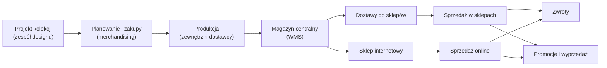
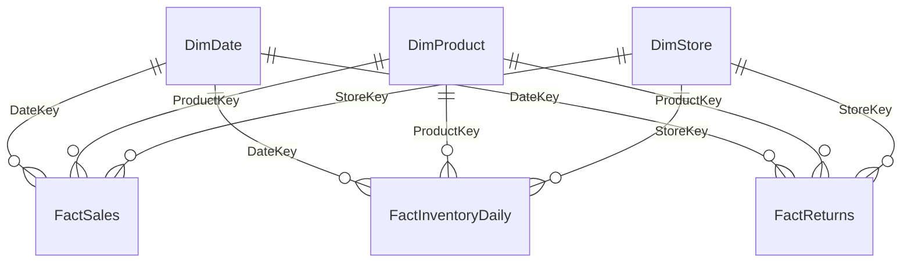

# Nordvik — opis firmy i modelu działania

## Spis treści

1. Profil firmy
2. Model biznesowy
3. Sklepy i kanały
4. Asortyment i produkt
5. Organizacja i odpowiedzialności
6. Rytm pracy firmy
7. Dane: źródła i hurtownia
8. Metryki
9. Data Science w Nordvik
10. Słownik pojęć
11. Założenia i źródła
 dasd
---

## 1. Profil firmy

| Obszar | Opis |
| --- | --- |
| Branża | Moda odzieżowa, sieć z własną ofertą (model *own brand*) |
| Sklepy stacjonarne | 5 |
| Sklep internetowy | 1 (kanał `ONLINE`) |
| Asortyment | Odzież damska i męska, akcesoria. Ok. 120 SKU (uproszczenie: prawdziwa sieć ma ich wielokrotnie więcej) |
| Sezony | `SS` (luty–lipiec) i `AW` (sierpień–styczeń), np. `AW26` |
| Waluta i VAT | PLN. VAT 23% na odzież |
| Historia danych | Sprzedaż od stycznia 2025. Stany magazynowe i zwroty za bieżący sezon |

---

## 2. Model biznesowy

### 2.1 Łańcuch wartości



### 2.2 Co firma zarabia i co ją kosztuje

- **Marża z własnego projektu.** Nordvik projektuje i zleca produkcję. Nie handluje cudzymi markami.
- **Zysk zależy od trzech rzeczy:**
  - trafności zakupu (ile z dostawy sprzedano przy pełnej cenie),
  - utrzymania ceny (ile oddano w rabatach),
  - kosztu zwrotów (szczególnie online).
- **Niesprzedany towar na koniec sezonu** = przecena lub wyprzedaż poniżej kosztu pozyskania marży.
- **Rozmiary.** Popyt skupia się na M i L. XS i XL to typowe ryzyko nadmiaru (*założenie zgodne z praktyką branży*).

### 2.3 Cykl życia produktu w sezonie

| Etap | Cena | Cel | Czas trwania (*założenie*) |
| --- | --- | --- | --- |
| Wejście do sprzedaży | Pełna (`ListPrice`) | Sprzedaż przy pełnej marży | 4–6 tygodni |
| Sezon podstawowy | Pełna, ewentualnie akcje | Sprzedaż głównej części dostawy | do ok. 8 tygodni |
| Rabat sezonowy | −20% do −30% | Rozładowanie zapasu | 2–3 tygodnie |
| Wyprzedaż końcowa | −40% do −60% | Zamknięcie sezonu | do końca sezonu |

### 2.4 Kanały

| Kanał | Udział w przychodzie | Zwroty (sztuki) |
| --- | --- | --- |
| Sklepy stacjonarne | ok. 78% (*orientacyjnie*) | ok. 4% (*orientacyjnie*) |
| Sklep internetowy | ok. 22% (*orientacyjnie*) | ok. 18% (*orientacyjnie*) |

Kanały porównujemy osobno. Wyższy wskaźnik zwrotów online jest cechą kanału, a nie sygnałem problemu.

---

## 3. Sklepy i kanały

| Sklep | Kanał | Miasto | Powierzchnia sprzedaży | Uwagi |
| --- | --- | --- | --- | --- |
| Nordvik Arkadia | `STORE` | Warszawa | 420 m² | Duży format w centrum handlowym |
| Nordvik Mokotów | `STORE` | Warszawa | 260 m² | Format uliczny |
| Nordvik Kraków Rynek | `STORE` | Kraków | 180 m² do marca 2026, **320 m² od kwietnia 2026** | Po przebudowie i powiększeniu |
| Nordvik Poznań | `STORE` | Poznań | 300 m² | Centrum handlowe |
| Nordvik Gdańsk | `STORE` | Gdańsk | 240 m² | Format uliczny |
| Nordvik Online | `ONLINE` | Brak | Brak (nie dotyczy) | Sklep internetowy |

Powierzchnia w hurtowni to **bieżący metraż**. Historia zmian to data przebudowy (`RemodelDate`), nie dawna powierzchnia.

---

## 4. Asortyment i produkt

### 4.1 Hierarchia produktu

```text
Dział (WOMEN / MEN / UNISEX)
└── Kategoria (Kurtki, Sukienki, Swetry, Jeansy, T-shirty, Koszule, Akcesoria)
    └── Model = StyleCode          np. W-JKT-001  "Kurtka pikowana damska"
        └── SKU = model × kolor × rozmiar      np. W-JKT-001-CZA-M
```

### 4.2 Zasady asortymentu

- Rozmiary: `XS`, `S`, `M`, `L`, `XL`. Akcesoria mają rozmiar `ONE`.
- Kolekcje sezonowe: np. `AW25`, `SS26`, `AW26`.
- Cena katalogowa (`ListPrice`) jest **bieżąca** i zawiera VAT.
- Koszt jednostkowy (`UnitCost`) jest kopiowany na pozycję sprzedaży w chwili sprzedaży.
- `IsActive` oznacza SKU aktualnie w ofercie.

---

## 5. Organizacja i odpowiedzialności

| Dział | Odpowiada za | Typowe pytanie |
| --- | --- | --- |
| Design | Kolekcje, wzory, modele | Które modele wchodzą w sezon? |
| Merchandising i zakupy | Ilości, rozmiary, dostawy | Ile kupić i w jakich rozmiarach? |
| Pricing i promocje | Ceny, rabaty, kampanie | Czy rabat się opłacił? |
| Logistyka | Magazyn centralny, dostawy do sklepów | Gdzie są zapasy i czy są dostępne? |
| Sprzedaż (sklepy) | 5 sklepów, regiony | Dlaczego ten sklep sprzedaje słabiej? |
| E-commerce | Sklep internetowy | Jak zachowują się klienci online? |
| Obsługa zwrotów | Portal zwrotów | Dlaczego klienci zwracają towar? |
| Finanse i controlling | Wyniki, raporty zarządcze | Czy liczby się zgadzają? |
| Analityka biznesowa | Raporty cykliczne, analizy ad hoc | Co się zmieniło i dlaczego? |
| Data Science | Modele predykcyjne, eksperymenty | Ile sprzedamy? Jaka cena da lepszy wynik? |
| Data Engineering | Hurtownia, ładowanie, jakość danych | Czy dane są kompletne? |

---

## 6. Rytm pracy firmy

| Kiedy | Co się dzieje |
| --- | --- |
| Codziennie | Systemy źródłowe wystawiają pliki raz na dobę. Hurtownia jest ładowana w całości |
| Poniedziałek rano | Przegląd handlowy: sprzedaż netto poprzedniego tygodnia ISO, zmiana tydzień do tygodnia i rok do roku |
| Koniec miesiąca | Zamknięcie miesiąca, przegląd marżowy, karta wyników sklepów |
| Przed sezonem | Plan zakupów i alokacji na sezon `SS` lub `AW` |
| W trakcie sezonu | Decyzje o rabacie sezonowym i wyprzedaży |
| Listopad | Black Friday, silny wzrost sprzedaży |
| Grudzień | Szczyt sprzedaży przed świętami |
| Luty | Najsłabszy miesiąc (*orientacyjnie*) |

---

## 7. Dane: źródła i hurtownia

### 7.1 Systemy źródłowe

| System | Co wystawia | Plik | Tabela wejściowa |
| --- | --- | --- | --- |
| POS (kasy w sklepach) | Pozycje paragonów ze sklepów stacjonarnych | `POS_yyyymmdd.csv` | `src.SalesRaw` |
| Sklep internetowy | Pozycje zamówień online | `WEB_yyyymmdd.csv` | `src.SalesRaw` |
| WMS (magazyn) | Stany na koniec dnia, osobny plik na dzień | `WMS_yyyymmdd.csv` | `src.InventoryRaw` |
| Portal zwrotów | Przyjęte zwroty | `RET_yyyymm.csv` | `src.ReturnsRaw` |

### 7.2 Warstwy hurtowni

Dane płyną w jedną stronę: `src` → `stg` → `dbo` → `reporting`.

| Schemat | Zawartość | Uwaga |
| --- | --- | --- |
| `src` | Dane takie, jak przysłał system źródłowy. Wszystko tekstowe, bez walidacji | Źródło prawdy o tym, co przyszło |
| `stg` | Dane po konwersji typów | Wiersze, których nie da się przekonwertować, odpadają |
| `dbo` | Wymiary i fakty | Właściwa hurtownia |
| `reporting` | Widoki raportowe | Warstwa, z której korzysta biznes |
| `etl` | Procedury ładujące | Pełne przeładowanie przy każdym uruchomieniu |

### 7.3 Model gwiazdy



| Tabela | Typ | Ziarno (jeden wiersz to…) | Najważniejsze kolumny |
| --- | --- | --- | --- |
| `dbo.DimDate` | Wymiar | Dzień | `DateKey`, `YearWeek` (np. `2026-W38`), `YearMonth`, `Season`, `IsWeekend` |
| `dbo.DimProduct` | Wymiar | SKU | `SKU`, `StyleCode`, `Department`, `Category`, `Color`, `Size`, `ListPrice`, `UnitCost`, `IsActive` |
| `dbo.DimStore` | Wymiar | Sklep (także online) | `StoreKey`, `StoreCode`, `City`, `Region`, `Channel`, `Format`, `SalesAreaM2`, `RemodelDate` |
| `dbo.FactSales` | Fakt | Pozycja paragonu lub zamówienia | `TransactionNo`, `LineNumber`, `Quantity`, `UnitPrice`, `DiscountAmount`, `GrossAmount`, `NetAmount`, `UnitCost` |
| `dbo.FactInventoryDaily` | Fakt (migawka) | Dzień × SKU × sklep | `StockQuantity` |
| `dbo.FactReturns` | Fakt | Pozycja zwrotu | `ReturnNo`, `TransactionNo`, `Quantity`, `ReturnAmount` (z VAT), `ReturnReason` |
| `dbo.LoadLog` | Audyt | Jedno uruchomienie ładowania | `RowsRead`, `RowsLoaded`, `RowsRejected`, `Status` |

### 7.4 Zasady łączenia danych

- Fakty łączymy z wymiarami po kluczach surogatowych: `DateKey`, `ProductKey`, `StoreKey`.
- `FactReturns` łączy się ze sprzedażą po `TransactionNo` **i** `ProductKey`. Samo `TransactionNo` mnoży wiersze, bo jeden paragon ma wiele pozycji.
- `FactInventoryDaily` to **migawka**. Stanów z kolejnych dni nie sumujemy. Różnica dwóch migawek to nie sprzedaż, bo wpływają na nią też dostawy i przesunięcia.
- Zwrot ma datę i sklep **przyjęcia**, nie datę i kanał sprzedaży.
- Sprzedaż nie wskazuje kupującego. Analizy klientów nie są możliwe na tym zbiorze.

### 7.5 Czego w hurtowni nie ma

- Dostaw do sklepów i przesunięć między sklepami (jest tylko stan wynikowy).
- Danych klienta: identyfikatora, karty lojalnościowej, konta.
- Ruchu na stronie i lejka e-commerce (sesje, koszyk, checkout).
- Historii cen. Jest cena na pozycji paragonu, ale nie historia cennika.
- Danych zewnętrznych: pogody, kalendarza wydarzeń, marketingu.
- Historii metrażu sklepu. Jest tylko bieżący metraż i data przebudowy.

### 7.6 Jakość danych w praktyce

- Ponowne wgranie pliku źródłowego może zduplikować wiersze.
- Plik stanów z magazynu bywa niekompletny: brakuje pliku za wybrany dzień.
- Ta sama metryka bywa opisana inaczej w dokumentacji i w widoku.
- Widoki powstawały pod różne pytania. Nazwa widoku nie zawsze oznacza to, co liczy.
- Zwroty są księgowane w dniu przyjęcia, nie w dniu sprzedaży.

---

## 8. Metryki

Pełna lista z definicjami: `slownik-metryk.md`. Najważniejsze:

| Metryka | Definicja |
| --- | --- |
| Sprzedaż brutto | Wartość sprzedaży z VAT, po odjęciu rabatu |
| Sprzedaż netto | Sprzedaż brutto / 1,23. Domyślna miara w raportach zarządczych |
| Sztuki | Suma `Quantity` |
| Koszt własny (COGS) | Suma `Quantity × UnitCost` |
| Marża brutto | Sprzedaż netto − COGS − wartość zwrotów netto z tego samego okresu |
| Liczba transakcji | `COUNT(DISTINCT TransactionNo)`. Nie `COUNT(*)`, bo to liczba pozycji |
| Średni koszyk | Sprzedaż netto / liczba transakcji |
| UPT (sztuki na transakcję) | Sztuki / liczba transakcji. Typowo 2–4 |
| Przychód na m² | Sprzedaż netto / powierzchnia sprzedaży. Tylko sklepy stacjonarne |
| Dostępność | Udział SKU ze stanem > 0 w SKU objętych zapasem, na dzień i sklep |
| Sell-through | Sprzedane w sezonie / (sprzedane w sezonie + stan na koniec okresu). Liczony tylko w obrębie jednego sezonu |
| Wskaźnik zwrotów | Sztuki zwrócone / sztuki sprzedane w tym samym okresie i przekroju |

---

## 9. Data Science w Nordvik

Analityk odpowiada na pytanie „co się stało i dlaczego?". Data Science odpowiada na pytania „co się stanie?", „co da lepszy wynik?" i „czy to naprawdę zadziałało?".

### 9.1 Podział ról

| Działanie | Analityk | Data Scientist | Data Engineer |
| --- | --- | --- | --- |
| Pytanie „co się stało?" | Główny wykonawca | Wsparcie | Dostarcza dane |
| Pytanie „co się stanie?" | Ocena wyniku | Główny wykonawca | Dostarcza dane |
| Definicje metryk | Współtworzy | Używa | Wdraża w hurtowni |
| Jakość i ładowanie danych | Zgłasza problemy | Zgłasza problemy | Główny wykonawca |
| Wdrożenie i monitoring modelu | Sprawdza wynik | Główny wykonawca | Wspólnie |
| Raport dla biznesu | Główny wykonawca | Dostarcza wynik modelu | Nie dotyczy |

### 9.2 Obszary pracy Data Science

| # | Obszar | Problem biznesowy | Dane wejściowe | Wynik dla biznesu | Status dziś |
| --- | --- | --- | --- | --- | --- |
| 1 | Prognoza popytu | Ile sztuk modelu sprzedamy w sklepie w ciągu 4 tygodni? | `FactSales`, `DimDate`, `DimProduct`, `DimStore` | Prognoza na tydzień × SKU × sklep. Podstawa zakupów i alokacji | Możliwe z tabel faktów |
| 2 | Prognoza sell-through i moment przeceny | Czy zapas dojdzie do końca sezonu? Kiedy obniżyć cenę? | `FactSales`, `FactInventoryDaily` | Data i poziom rabatu dla modelu | Możliwe dla bieżącego sezonu |
| 3 | Elastyczność cenowa | O ile spadnie popyt przy −20%? | `FactSales.UnitPrice`, `DiscountAmount`, `Quantity` | Krzywa popytu i rekomendacja rabatu | Możliwe. Trzeba odsiać sezonowość |
| 4 | Krzywa rozmiarów i alokacja | Jaki udział każdego rozmiaru zamówić i rozdać do sklepów? | `FactSales`, `FactInventoryDaily`, `DimProduct.Size` | Proporcje rozmiarów dla sklepu i kanału | Możliwe |
| 5 | Uzupełnianie zapasu | Kiedy i ile dosłać do sklepu? | `FactInventoryDaily`, prognoza popytu | Minimalny i docelowy stan dla SKU × sklep | Częściowo. Brak danych o dostawach |
| 6 | Prognoza zwrotów | Które modele i rozmiary będą najczęściej zwracane? | `FactReturns`, `FactSales`, `DimProduct` | Przewidywany wskaźnik zwrotów dla modelu i rozmiaru | Częściowo. Brak danych o zamówieniu i kliencie |
| 7 | Koszyk i „kupione razem" | Co najczęściej kupowane jest razem z kurtką? | `FactSales` (`TransactionNo`) | Reguły współzakupu dla sklepów i online | Możliwe. Personalizacja wymaga ID klienta |
| 8 | Segmentacja klientów | Kto wraca, a kto odchodzi? | ID klienta z karty lub konta | Segmenty (RFM) i wskaźnik odejścia | Brak danych |
| 9 | Pomiar wpływu | Czy remont albo promocja zwiększyły sprzedaż, czy tylko ją przesunęły? | `FactSales`, sklepy kontrolne, `RemodelDate` | Przyrost z przedziałem niepewności | Możliwe przez sklepy kontrolne. Brak randomizacji |
| 10 | Testy A/B | Czy nowy układ strony zwiększa konwersję? | Zdarzenia z sesji web | Wynik eksperymentu | Brak danych web |
| 11 | Wykrywanie anomalii | Czy sprzedaż dnia lub sklepu odbiega od normy? Czy plik się zdublował? | `FactSales`, `dbo.LoadLog`, `src.*` | Alerty dla analityków i data engineeringu | Możliwe |
| 12 | Cechy do modeli (feature store) | Wspólne, wersjonowane cechy: tydzień, sezon, kalendarz | `DimDate`, dane zewnętrzne | Widoki cech dla wszystkich modeli | Planowane |
| 13 | Dane pogodowe | Czy temperatura przesuwa sprzedaż kurtek? | Źródło pogodowe | Zmienna w prognozie | Brak źródła |
| 14 | Klasyfikacja atrybutów z opisów | Czy opis „pikowana, wodoodporna" trafia do właściwych atrybutów? | Nazwy i opisy produktów | Ujednolicone atrybuty w `DimProduct` | Planowane. Opisy poza hurtownią |
| 15 | Monitoring modeli | Czy prognoza działa nadal po zmianie kolekcji? | Prognoza vs sprzedaż rzeczywista | Alert o dryfcie i decyzja o przeuczeniu | Planowane |

### 9.3 Jak wygląda projekt Data Science

1. **Pytanie biznesowe i metryka sukcesu.** Np. „błąd prognozy tygodniowej poniżej 30% na modelach z top 20 sprzedaży".
2. **Dane i definicje.** Wspólnie z analitykami, z użyciem słownika metryk.
3. **Baseline.** Prosty punkt odniesienia: średnia z ostatnich tygodni albo sezonowa średnia z roku poprzedniego. Model musi go pokonać.
4. **Model i walidacja w czasie.** Testujemy na przyszłych tygodniach (*backtest*), nigdy na losowym podziale wierszy.
5. **Wdrożenie.** Wynik trafia do tabeli lub widoku w warstwie `reporting`.
6. **Monitoring.** Co miesiąc: błąd (WAPE, obciążenie), porównanie z baseline, sygnał zmiany w danych.

### 9.4 Ograniczenia, które wszyscy znają

- Sprzedaż na poziomie SKU × sklep × dzień jest rzadka. Prognozujemy na poziomie tygodnia, modelu albo regionu.
- Sezonowość zmienia się z kolekcji na kolekcję. Model sezonowy z jednego roku nie przenosi się wprost na kolejny.
- Brak danych o klientach ogranicza modele do poziomu produktu, sklepu i kanału.
- Każdy wynik modelu jest opinią z ryzykiem błędu. Trafia do biznesu z przedziałem niepewności, a nie jako pewna liczba.

---

## 10. Słownik pojęć

| Pojęcie | Znaczenie |
| --- | --- |
| SKU | Konkretny wariant produktu: model × kolor × rozmiar |
| StyleCode | Kod modelu, grupuje warianty SKU |
| Sezon SS / AW | Wiosna–lato (luty–lipiec) i jesień–zima (sierpień–styczeń) |
| Kolekcja | Dostawa produktów w ramach sezonu, np. `AW26` |
| Markdown | Obniżka ceny produktu w trakcie sezonu |
| Sell-through | Udział sprzedanych sztuk w sumie sztuk dostępnych w sezonie |
| Krzywa rozmiarów | Proporcje sprzedaży lub zakupu między rozmiarami |
| Ziarno (grain) | Co oznacza jeden wiersz w tabeli |
| Wymiar (dim) | Tabela opisowa: produkt, sklep, data |
| Fakt (fact) | Tabela z miarami: sprzedaż, stany, zwroty |
| Migawka (snapshot) | Stan na dany moment, nie suma ruchów |
| `src`, `stg`, `dbo`, `reporting` | Warstwy hurtowni: lądowanie, staging, hurtownia, raporty |
| Backtest | Test modelu na danych z przyszłości względem danych treningowych |
| WAPE | Suma błędów bezwzględnych / suma sprzedaży rzeczywistej |
| Baseline | Prosty punkt odniesienia dla modelu |
| Uplift | Przyrost wyniku wynikający z działania, np. promocji |
| Drift | Zmiana rozkładu danych, która pogarsza działanie modelu |

---

## 11. Założenia i źródła

### 11.1 Co jest założeniem

- Wartości **orientacyjne**: udziały kanałów, wskaźniki zwrotów, czasy etapów cyklu cenowego, sezon lutowy jako dołek.
- Liczba SKU i profil asortymentu: uproszczenie.
- Format sklepów (galeria, ulica) jest opisowy i nie wpływa na dane.
- Nazwy sklepów i metraż wymagają potwierdzenia przed publikacją.

### 11.2 Skąd wzięto opis

| Źródło | Co wykorzystano |
| --- | --- |
| Rozmowa „Rola data analysta w retailu" (ChatGPT, 2026-09-21) | Przykład firmy typu LPP i Reserved. Typowe pytania analityka: sprzedaż, produkty, stany, promocje, sklepy, e-commerce, sell-through, alokacja. Liczby z tej rozmowy (np. „500 modeli", „setki sklepów") nie są zweryfikowane i nie zostały użyte w opisie Nordvik |
| Notatka z nocnej przebudowy modelu (materiały warsztatu) | Plan modelu fashion retail: tabele, kategorie, sklepy, kanały, sezony i historie w danych |
| Dokumentacja `model-danych`, `slownik-metryk`, `zrodla-danych`, `raporty` | Ziarno faktów, definicje metryk, pliki źródłowe, braki w danych, widoki raportowe |
| Definicje tabel i widoków w projekcie hurtowni | Nazwy kolumn, typy, komentarze o ziarnie, lista widoków |
| Wiedza ogólna o branży | Sezonowość SS/AW, cykl przeceny, krzywa rozmiarów, magazyn centralny, zwroty online |

Odwołania do Reserved i LPP dotyczą wyłącznie przykładów w materiałach projektu. Nordvik nie korzysta z danych ani struktur tych firm.
