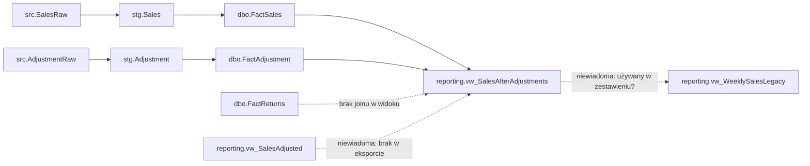
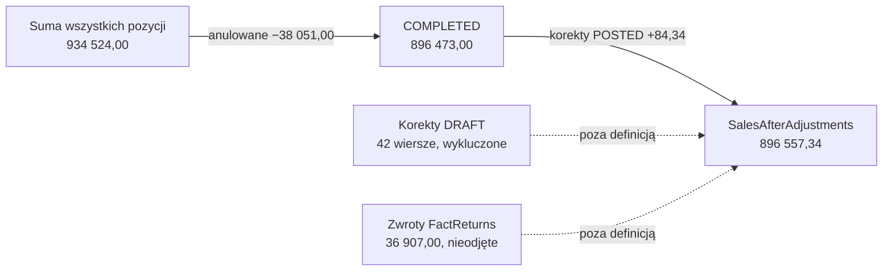
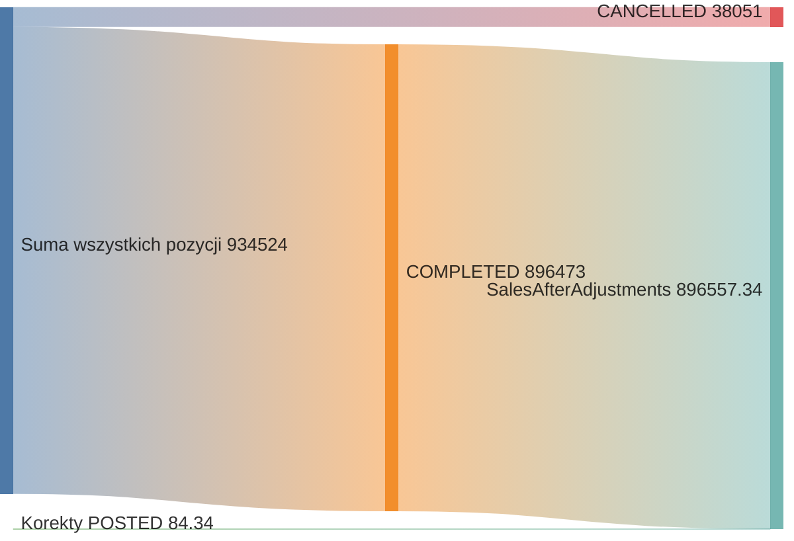
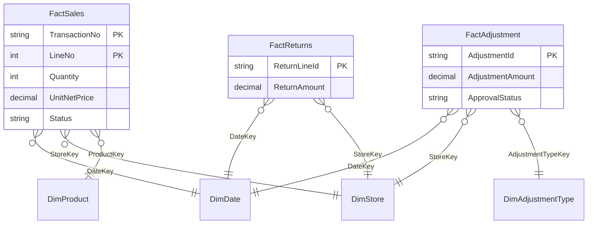
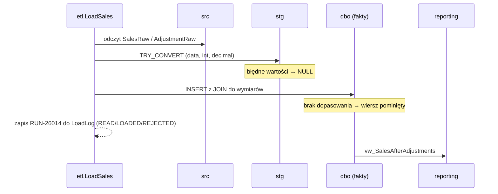
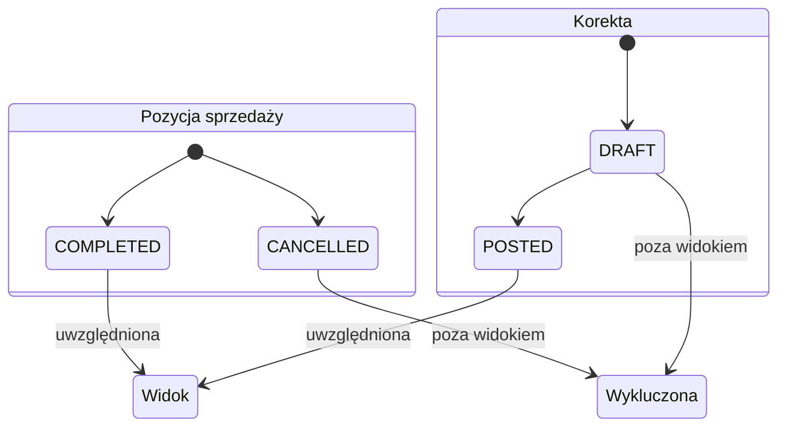
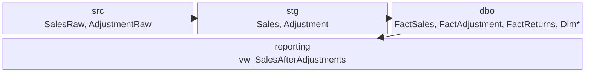
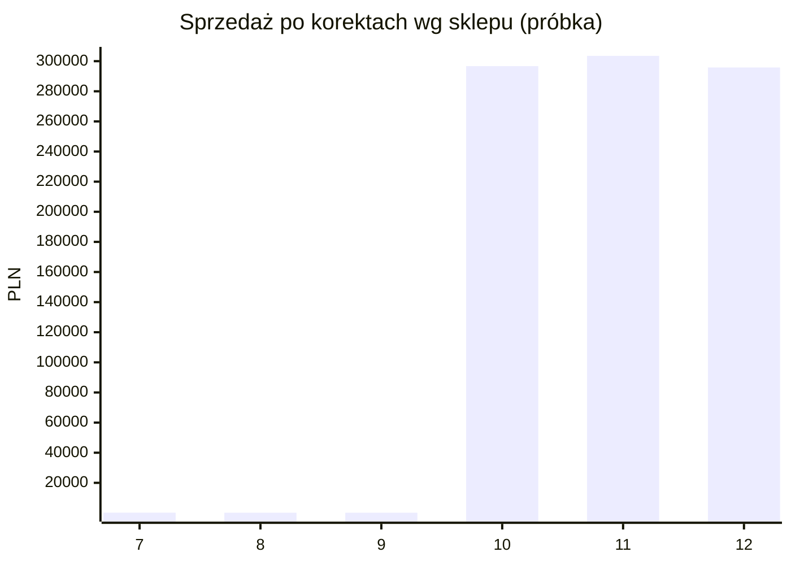
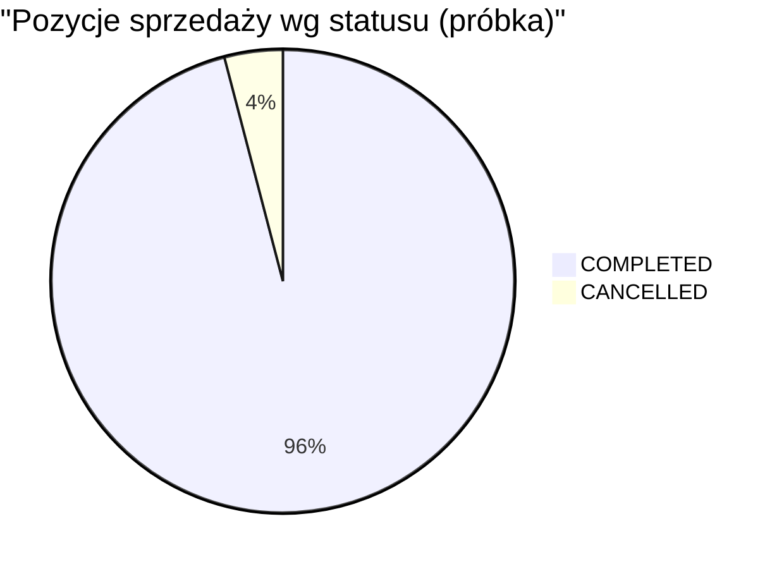

# Lineage: sprzedaż po korektach

## 1. Tabela lineage

| Pole biznesowe | Kolumna techniczna | Raport/widok | Transformacja/formuła | Źródło | Ziarno | Wersja/czas | Dowód / niewiadoma |
|---|---|---|---|---|---|---|---|
| sprzedaż po korektach | `reporting.vw_SalesAfterAdjustments.SalesAfterAdjustments` | `reporting.vw_SalesAfterAdjustments` | sprzedaż `COMPLETED` + korekty `POSTED` | `FactSales` + `FactAdjustment` | sklep × ISO tydzień | REL-2026.10.3 (13.10.2026 17:20); katalog CAT-2026.10 (14.10.2026 08:00) | [implementacja.sql](/home/teamsharq/Desktop/infoshare-silkycoders-data-science-ai-1/zgloszenia/E02-B/implementacja.sql) |
| sprzedaż po korektach — zwroty | brak w widoku | `dbo.FactReturns` | nieodejmowane (brak joinu) | `dbo.FactReturns` | pozycja zwrotu | REL-2026.10.3 | komentarz w `implementacja.sql`; w próbce 36 907,00 |
| sprzedaż po korektach — legacy | `reporting.vw_WeeklySalesLegacy` | obiekt wycofany | tydzień kalendarzowy, nie ISO | nieznane | sklep × tydzień kalendarzowy | emerytowany wg katalogu | [katalog.md](/home/teamsharq/Desktop/infoshare-silkycoders-data-science-ai-1/zgloszenia/E02-B/katalog.md); niewiadoma: czy zestawienie go używa |
| sprzedaż po korektach — alias | `reporting.vw_SalesAdjusted` | nieznany | nieznana | nieznane | nieznane | brak w eksporcie | niewiadoma: brak definicji |

### Łańcuch źródeł

- **Sprzedaż:** `src.SalesRaw` → `stg.Sales` → `dbo.FactSales`
- **Korekty:** `src.AdjustmentRaw` → `stg.Adjustment` → `dbo.FactAdjustment`
- **Dowody ETL:** [staging_fact.sql](/home/teamsharq/Desktop/infoshare-silkycoders-data-science-ai-1/zgloszenia/E02-B/staging_fact.sql), [adjustment_lineage.sql](/home/teamsharq/Desktop/infoshare-silkycoders-data-science-ai-1/zgloszenia/E02-B/adjustment_lineage.sql)

## 2. Komunikat dla controllingu

### Ustalone fakty

- Pole pochodzi z `reporting.vw_SalesAfterAdjustments` (REL-2026.10.3).
- Formuła: suma `Quantity × UnitNetPrice` dla `COMPLETED` + suma `AdjustmentAmount` dla `POSTED`, per sklep i ISO tydzień.
- Próbka (`przyklad_wierszy.csv`, 3 705 wierszy, dane syntetyczne):
  - suma wszystkich pozycji sprzedaży: **934 524,00**
  - anulowane (`CANCELLED`, 125 poz.): **−38 051,00**
  - `COMPLETED`: **896 473,00**
  - korekty `POSTED` (DRAFT, 42 wiersze, wykluczone): **+84,34**
  - wynik widoku: **896 557,34**
- Zwroty (`FactReturns`) w próbce: 36 907,00, nieodejmowane w widoku.
- Load log RUN-26014: 12 odczytanych, 10 załadowanych, 2 odrzucone (`RejectedSales`).
- Jedna korekta `POSTED` (23,83) nie ma sprzedaży `COMPLETED` w tym samym sklepie i tygodniu, więc LEFT JOIN ją gubi.

### Hipotezy do sprawdzenia

- Różnica względem „sumy paragonów” wynika najpewniej z anulowanych pozycji (38 051) i pominięcia zwrotów (36 907). Potwierdzić, jak controlling liczy paragony.
- Możliwe przypisanie do innego tygodnia, jeśli zestawienie używa `vw_WeeklySalesLegacy` (tydzień kalendarzowy). Sprawdzić źródło zestawienia.
- Możliwa cicha utrata wierszy: `TRY_CONVERT` daje NULL, a INNER JOIN do wymiarów odrzuca wiersz bez wpisu w `LoadLog`. Porównać liczby wierszy `src` → `stg` → `Fact`.
- Znak korekt: w próbce 159 ujemnych wartości. Potwierdzić, że źródło podaje znak zgodny z definicją.

### Braki i granice wniosku

- Próbka jest syntetyczna i nie pokazuje skali różnicy w produkcyjnym zestawieniu.
- Brak definicji „sumy paragonów” i zapytania zestawienia tygodniowego.
- `vw_SalesAdjusted` nie został zweryfikowany (brak w eksporcie schematu).
- Brak liczników odrzuceń z pełnych ładowań.

### Krótka odpowiedź

- Liczba pochodzi z `vw_SalesAfterAdjustments`: sprzedaż `COMPLETED` + korekty `POSTED`.
- Różnica od paragonów wynika z definicji, nie z błędu wartości: widok pomija zwroty, uwzględnia tylko pozycje `COMPLETED` i gubi korekty bez sprzedaży w tym tygodniu.
- Przed zamknięciem: potwierdzić definicję „sumy paragonów” i sprawdzić, czy zestawienie nie używa obiektu legacy.

## 3. Diagramy

**Legenda**
- linia ciągła `-->` — potwierdzone w SQL
- linia przerywana `-.->` — niewiadoma lub element spoza wyniku widoku

### 3.1 Lineage



*Źródło liczb: diagram pokazuje ścieżki z definicji obiektów (`implementacja.sql`, `staging_fact.sql`, `adjustment_lineage.sql`), bez wartości z próbki.*

### 3.2 Mostek kwot



*Źródło liczb: sumy z próbki [przyklad_wierszy.csv](/home/teamsharq/Desktop/infoshare-silkycoders-data-science-ai-1/zgloszenia/E02-B/przyklad_wierszy.csv) (dane syntetyczne), wyliczone wg formuły widoku.*

### 3.3 Mostek kwot (sankey-beta)



*Źródło liczb: sumy z próbki [przyklad_wierszy.csv](/home/teamsharq/Desktop/infoshare-silkycoders-data-science-ai-1/zgloszenia/E02-B/przyklad_wierszy.csv) wg formuły widoku; wartości zaokrąglone do pełnych złotych, korekta 84,34 zostawiona dokładnie.*

### 3.4 Model danych (erDiagram)



*Źródło: definicje tabel w [schema.sql](/home/teamsharq/Desktop/infoshare-silkycoders-data-science-ai-1/zgloszenia/E02-B/schema.sql); diagram nie zawiera liczb. Relacje `FactReturns` → `FactSales` nie są zdefiniowane w schemacie, więc nie są pokazane.*

### 3.5 Kolejność ładowania (sequenceDiagram)



*Źródło: kolejność z [staging_fact.sql](/home/teamsharq/Desktop/infoshare-silkycoders-data-science-ai-1/zgloszenia/E02-B/staging_fact.sql) i [adjustment_lineage.sql](/home/teamsharq/Desktop/infoshare-silkycoders-data-science-ai-1/zgloszenia/E02-B/adjustment_lineage.sql) oraz [loadlog.csv](/home/teamsharq/Desktop/infoshare-silkycoders-data-science-ai-1/zgloszenia/E02-B/loadlog.csv): 12 odczytanych, 10 załadowanych, 2 odrzucone.*

### 3.6 Statusy (stateDiagram-v2)



*Źródło: filtry `Status='COMPLETED'` i `ApprovalStatus='POSTED'` w [implementacja.sql](/home/teamsharq/Desktop/infoshare-silkycoders-data-science-ai-1/zgloszenia/E02-B/implementacja.sql); przejście DRAFT → POSTED nie jest opisane w SQL, więc jest to niewiadoma.*

### 3.7 Wydania i obowiązywanie (timeline)

```mermaid
timeline
  title Wersje i przebiegi
  section Wdrożenie
    13.10.2026 17:20 : REL-2026.10.3 opublikowany
  section Katalog i ładowanie
    14.10.2026 02:00 : RUN-26014 etl.LoadSales (2 odrzucone)
    14.10.2026 08:00 : Katalog CAT-2026.10 wyeksportowany
  section Obiekty
    data nieznana : vw_WeeklySalesLegacy emerytowany
    data nieznana : vw_SalesAdjusted, brak w eksporcie
```

*Źródło: [implementacja.sql](/home/teamsharq/Desktop/infoshare-silkycoders-data-science-ai-1/zgloszenia/E02-B/implementacja.sql), [katalog.md](/home/teamsharq/Desktop/infoshare-silkycoders-data-science-ai-1/zgloszenia/E02-B/katalog.md), [loadlog.csv](/home/teamsharq/Desktop/infoshare-silkycoders-data-science-ai-1/zgloszenia/E02-B/loadlog.csv); daty bez podanej godziny w katalogu są niepełne.*

### 3.8 Warstwy systemu (block-beta)



*Źródło: warstwy z [katalog.md](/home/teamsharq/Desktop/infoshare-silkycoders-data-science-ai-1/zgloszenia/E02-B/katalog.md) i [schema.sql](/home/teamsharq/Desktop/infoshare-silkycoders-data-science-ai-1/zgloszenia/E02-B/schema.sql); diagram nie zawiera liczb.*

### 3.9 Różnica per sklep (xychart-beta)



*Źródło: suma `COMPLETED` + `POSTED` per `StoreKey` z [przyklad_wierszy.csv](/home/teamsharq/Desktop/infoshare-silkycoders-data-science-ai-1/zgloszenia/E02-B/przyklad_wierszy.csv) (dane syntetyczne); sklepy 7–9 mają kilka wierszy, więc skala jest niewspółmierna. Nie pokazuje różnicy względem paragonów, bo ta nie jest rozbita per sklep w próbce.*

### 3.10 Udział anulowanych (pie)



*Źródło: sumy `Quantity × UnitNetPrice` wg `Status` z [przyklad_wierszy.csv](/home/teamsharq/Desktop/infoshare-silkycoders-data-science-ai-1/zgloszenia/E02-B/przyklad_wierszy.csv); korekty i zwroty nie są w tym wykresie, bo mają inne znaki i inne ziarno.*
